# Delay Dashboard — User Manual

This manual walks through the Delay Dashboard screen by screen, for anyone using it for the first time.

The screenshots were taken with real data from Aomori City Bus (青森市バス). Their dates and figures are from when they were taken, so the screens you open will show others. Every agency’s screens work the same way; where a report needs data that an agency’s feed does not send, the screen says so.

---

## Table of contents

1. [Choosing an agency](#1-choosing-an-agency)
2. [Finding your way around](#2-finding-your-way-around)
3. [The scope sentence: what a screen shows](#3-the-scope-sentence-what-a-screen-shows)
4. [Pulse — the period at a glance](#4-pulse--the-period-at-a-glance)
5. [Routes — which routes run late](#5-routes--which-routes-run-late)
6. [Time — when delay happens](#6-time--when-delay-happens)
7. [Why — what the data can explain](#7-why--what-the-data-can-explain)
8. [Compare — side by side](#8-compare--side-by-side)
9. [Live — the trips running now](#9-live--the-trips-running-now)
10. [Reports — documents to hand on](#10-reports--documents-to-hand-on)
11. [Ask — questions with ready answers](#11-ask--questions-with-ready-answers)
12. [Model evaluation — how the forecast model is checked](#12-model-evaluation--how-the-forecast-model-is-checked)
13. [Glossary](#13-glossary)

---

## 1. Choosing an agency

When you open the app, it first asks which agency (bus operator) you want to look at.

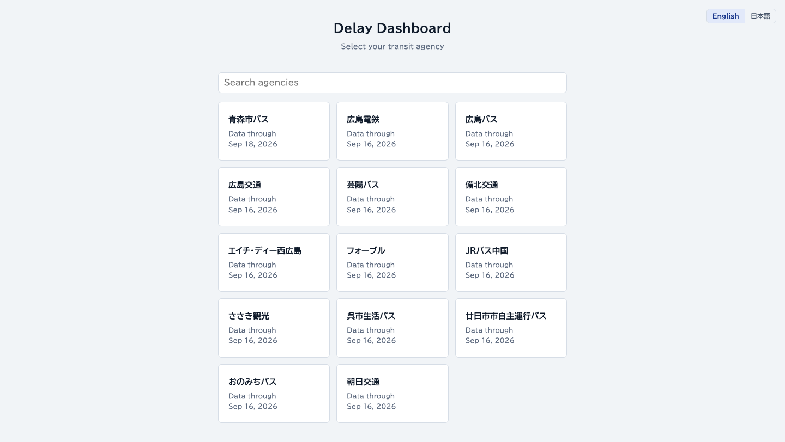

- Agencies are grouped by prefecture, the prefecture with the most agencies first. The number beside each heading is how many agencies it holds.
- How far the data reaches is shown once, above the cards (“Data through …”). An agency whose updates stopped several days before the others reads “No updates after …”. An agency whose data has not started arriving reads “No data collected yet”.
- Within a prefecture, agencies with data come first in name order, followed by those whose updates stopped and those with no data.
- When there are many agencies, a “Search by agency name” box appears above the cards.
- The language switch in the top-right corner changes the display language. The links at the bottom open Help, About this app and Sign in.

Click a card to open that agency’s **Pulse** screen (section 4). The app remembers your choice: the next time you open it, it goes straight to that agency’s Pulse. When only one agency is set up, this screen is skipped.

### Switching agencies

Open the agency menu at the top of the sidebar (the agency’s name with ▾), type part of a name to narrow the list, and pick another agency. You stay on the same screen, now for the new agency. From a route’s page you land on the **Routes** list instead, because routes belong to one agency. On a phone, the agency menu is under **More**.

You can also type an agency’s name into the search field at the top of the screen (section 2).

---

## 2. Finding your way around

### The sidebar

The sidebar on the left lists the screens. Each one answers one kind of question.

| Screen | What it answers |
|---|---|
| **Pulse** | How service ran over the period, and what changed |
| **Routes** | Which routes run late or on time, and how one route looks stop by stop |
| **Time** | When delay happens: by day, by hour and by day of the week |
| **Why** | Where the time goes: waiting at stops or running between them |
| **Compare** | Weekdays against weekends and holidays route by route, and agencies against each other |
| **Live** | The trips running now |
| **Reports** | Pages to print or hand on: a period summary, a council report, a delay record (for reference) |
| **Ask** | Ready-made questions, answered as tables and charts |

Under **Other** are **Model evaluation** (chapter 12), **Help** (this manual) and **About this app**. The arrow next to the app’s name collapses the sidebar to icons; hover over an icon to see its name.

The account menu at the bottom of the sidebar (your name, or **Guest**) holds sign-in, the display **Language** and the **Appearance** (follow the system, light or dark).

### My routes

A route you check often can go into **My routes** in the sidebar: press **Pin**, to the right of the heading on the route’s page (5-6). Each pinned route shows today’s mean delay; click it to open the route’s page. You can pin up to 5 routes per agency, and pressing **Pin** again unpins a route. Pins are kept in this browser only, so they work without signing in but do not appear in another browser or on another device. My routes is not shown on a phone-sized screen.

### Searching and jumping

The field at the top of every agency screen, “Search routes, reports and screens”, opens a search box (shortcut ⌘K on a Mac, Ctrl+K elsewhere). Type to jump to a screen, an agency, a route, a report or a time band.

Next to it, “Analyzed through …” shows the last service day the reports include. Click it to see “How fresh the data is”: how far the reports reach, when the last live reading arrived, and how many readings were set aside as implausible. Days without readings are left out, not counted as on time.

### On a phone

On a narrow screen the sidebar becomes a bar along the bottom with **Pulse**, **Routes**, **Live**, **Ask** and **More**. **More** holds the agency menu, the other screens, Model evaluation, Help and the account menu.

### Notices at the top

On Pulse, Routes, Time, Why and Compare, a notice can appear above the screen:

- “Data is out of date — last ingest: …” appears when no new reading has arrived for a day or more. Data collection is running behind; the app itself is working. Close the notice with ×.
- A “Feed health” notice says how many implausible readings (likely from a stuck or stale feed) were filtered out over the last 7 days. The figures on screen already leave them out.

---

## 3. The scope sentence: what a screen shows

**Pulse**, **Routes**, **Time**, **Why** and **Compare** (weekdays and weekends/holidays), and the period summary, council report and delay record (for reference) in **Reports**, open with one sentence that says what the screen is counting. With the default conditions it reads like this:

> Viewing all routes of (agency), (period), every day, all hours, counting on-time as within 1 min

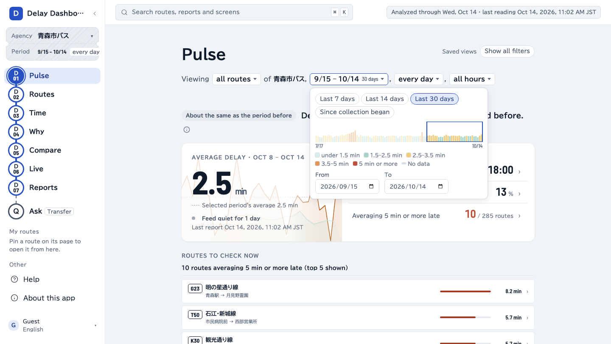

Each button with a ▼ is a condition. Click it to change it; the screen updates at once. A condition changed from its default shows in blue, and the period also shows how many days it covers.

| Condition | What you can choose |
|---|---|
| Routes | One or more routes, or all routes |
| Period | “Last 7 days”, “Last 14 days”, “Last 30 days” or “Since collection began”; a span dragged across the small daily chart; or exact “From” and “To” dates |
| Days and timetable | “All”, “Weekdays”, “Weekend” or single days of the week, and a “Timetable type” |
| Time of day | “All hours”, or a time band such as “Morning (05–09)” or “Evening (17–20)” |
| On-time tolerance | How late a departure can leave and still count as on time (“Counted on time up to”): 1, 3 or 5 min, each shown with the on-time share it gives |

The “Timetable type” choices follow the agency’s own timetable: weekdays, Saturdays, and Sundays & holidays, or weekdays and weekends & holidays for an agency whose Saturdays and Sundays share one timetable. Each day counts under the timetable the agency’s schedule ran that day, so a public holiday falls under the Sunday or weekend one.

By default a screen covers the 30 days up to the latest complete day with data, and the period choices end on that day too. A timetable type, and a stop, direction or early-departure allowance set by a link, join the sentence as extra conditions. On a screen that does not count on-time departures, the sentence ends before the on-time part.

Once you change any condition from its default, **Reset** appears at the end of the sentence and returns every condition to its default.

To the right of the screen's heading:

- **Saved views ▾** lists the views you have saved. Each shows its conditions under its name, and the one matching the current conditions has a ✓. Pick one to switch to it, or × to delete it. “Save current conditions” fills in a name suggested from the current conditions; keep it or change it, then press “Save”. Saving needs an account: signed out, it reads “Saved views” with the hint “Sign in to save”.
- **Show all filters** lays out the controls for every condition in a row under the sentence. It stays on until you turn it off.

A condition the screen does not use is struck through, and a line under the sentence names it, for example “Not used on this screen: Days and timetable”. The weekday and weekend reports, for instance, choose their own days.

Each screen keeps its own conditions while this browser tab stays open, so changing the period on **Routes** does not change it on **Time**. The conditions are also part of the page address, so a copied link opens the same view.

Live, Ask, a route’s page and the agency comparison have their own filters, described in their sections.

---

## 4. Pulse — the period at a glance

Pulse is the screen an agency opens on. It sums up the period in the scope sentence.

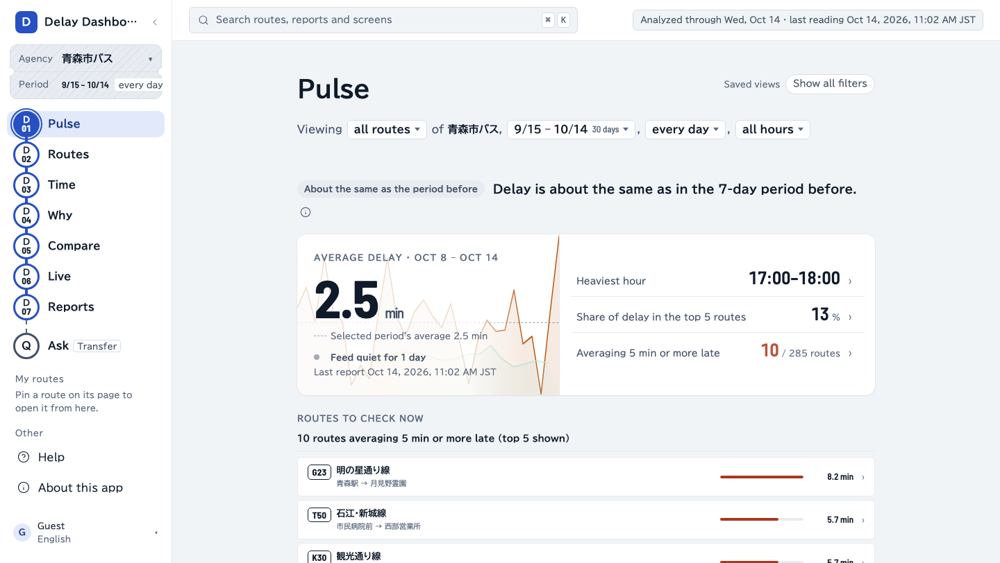

- The sentence at the top gives the average delay over the latest days (usually 7), the average over the same number of days just before them, and the change between the two in minutes and percent. The tag in front of it says “+… min on the … days before”, “−… min on the … days before” or “About the same as the … days before”. It says “about the same” only for a change under 0.1 min or under 5% of the earlier average. The ⓘ icon explains the comparison.
- A sentence about the latest day appears when the period’s last day is among the three slowest days observed in the period, with its average and its place. A day observed less than half as often as a usual day of its type (one collected only in part) is not ranked.
- “Average delay, last … days (…)”: the average delay in minutes, drawn over a small line of the daily values.
- The feed’s status, under the average delay: “Reporting live”, “Feed quiet for …” or “No reports yet”, with the time of the last report.
- Three rows beside the average delay: “Heaviest hour”, “Share of delay in the top … routes” (the part of all delay the top routes carry) and “Averaging … min or more late” (how many routes averaged at least a set number of minutes late, out of the routes observed 100 or more times over the latest days: the same number as the “… averaging … min or more late” heading of **Routes to check** below, when that heading appears). Click a row to open the card that explains it; “Averaging … min or more late” takes you to **Routes to check**.
- **Routes to check**: of the routes observed 100 or more times over the latest days, the most delayed, grouped by how late they ran on average. A route observed fewer times is left out, since a handful of trips can swing its average. Only the top routes are listed. When a group holds more routes than are listed, its heading gives the full count and says how many are shown (“top … shown”). Each row’s “vs last week” is its change from the same number of days before (missing for a route observed too little then). Click a route to open its page (section 5-6), or “See all … routes” to open the **Routes** table (section 5-3) over the same days, sorted by average delay, worst first. “No routes need attention” means none qualifies.
- **Delay concentration**, **Worst hour of day** and **By service day**: whether delay sits with a few routes, which hour runs latest, and how the day types compare: weekdays, Saturdays, and Sundays & holidays, or weekdays and weekends & holidays for an agency whose Saturdays and Sundays share one timetable. A day’s type is the timetable the agency’s schedule ran that day. A day type with too few days or observations shows “Not enough data” and is left out of the comparison. Click a card for a larger view. In **Worst hour of day**, click an hour to list the routes that ran late then.

If the period has no observations, the screen says so and suggests a change to the conditions.

---

## 5. Routes — which routes run late

### 5-1. The report screens

**Time**, **Why** and **Compare** (weekdays and weekends/holidays) share one layout, as do the council report and the delay record (for reference) in **Reports**. **Routes** holds every route in one table instead (5-3).

| Area | Where | What it holds |
|---|---|---|
| Scope sentence | Top | The conditions the report counts (section 3) |
| Report list | Left | This screen’s reports in groups such as “Rankings” and “Punctuality”, each with a one-line description |
| Report | Center | The chosen report: a table or charts, the period it covers (“Range: …”), and **Download CSV** where the report has rows to export |

A screen opens with its first report already showing; click another in the list to switch. On a phone, the list becomes a drop-down above the report.

If a report takes a while to count, after a few seconds it says “Still working on it…”. For a period longer than a week it says “Still working: a long period takes longer to count.” and offers **Narrow to the last 7 days of the period**.

### 5-2. Not sure how to read a report? Use the ⓘ icon

Click the small ⓘ next to the “Reports” heading above the list. A popup, “How to read these reports”, explains what each kind of report is for.

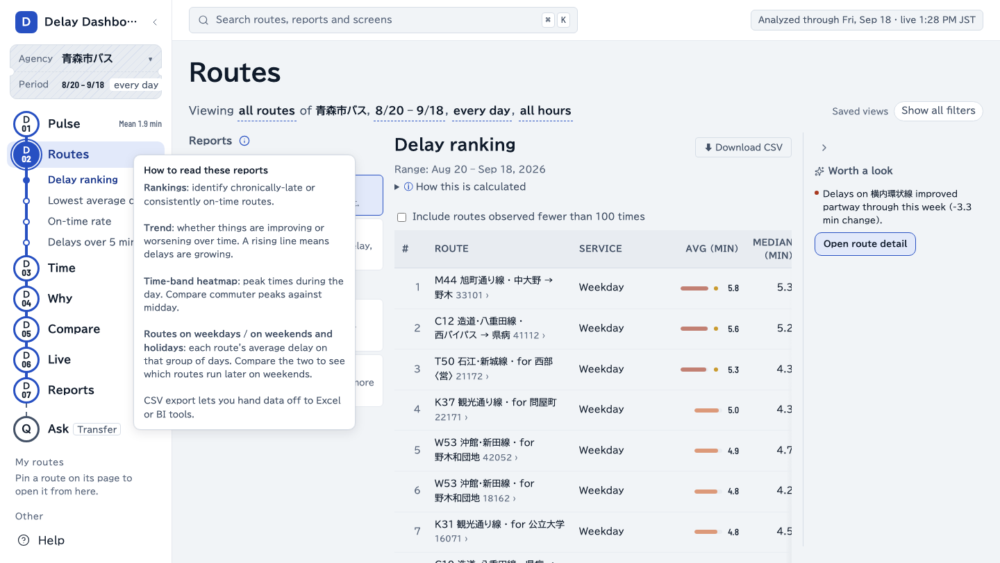

- Rankings find the routes that are chronically late or consistently on time.
- The trend shows whether things are improving or worsening; a rising line means delays are growing.
- The time-band heatmap shows the peak times of the day, such as commuter peaks against midday.
- Routes on weekdays and on weekends and holidays give each route’s average delay, with days split by the timetable the agency ran that day, so public holidays count as weekends and holidays; compare the two to see which routes run later on weekends and holidays.
- CSV export hands the data to Excel or other tools.

Click anywhere else, or press Escape, to close it.

### 5-3. The table on Routes

**Routes** lists the routes observed in the period in one table. Each row is one route, over all of its observations in the period. A line above the table names the period it counts (“30 days (…)”). **Pulse** counts a shorter, more recent period, so the same route can show different figures there.

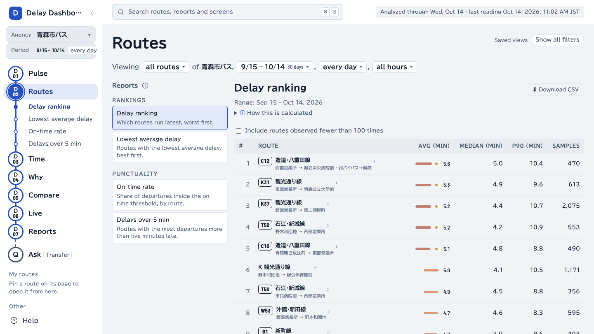

The columns:

- **Route**: click a name to open that route’s page (5-6). Where several routes share a name, where each runs is shown beside it.
- **Avg (min)**: the average delay.
- **On-time %**: the share of departures that left within the on-time tolerance in the scope sentence. Closer to 100% is better. A “wide margin” mark means the rate’s 95% interval is wider than ±5 points, so the percentage is hard to trust. The interval depends on the rate as well as on the number of departures, and widens as the rate nears 50%. Point at or focus the mark to see that route’s margin in points.
- **Share over 5 min** and **Over 5 min (count)**: the departures that left more than five minutes late, as a share and as a count.
- **Samples**: the number of observations behind the row. Fewer samples mean less certainty.

**Sort by** picks the figure the table is sorted by:

| Sort | Order |
|---|---|
| **Average delay** | Highest average delay first |
| **On-time rate** | Lowest on-time rate first |
| **Share over 5 min** | Highest share over 5 min first |
| **Impact (count)** | Most departures over 5 min first; busy routes rise to the top |

**Best first** starts from the other end. The sorted column’s figures are bold, and only that column carries a bar. The same four sorts sit under **Routes** in the sidebar.

If you are not sure where to start, sort by **Average delay** to see which routes are worst, then open the **Trend** on **Time** to see when.

### 5-4. Which routes the table lists

Routes observed fewer than 100 times in the period are left out, whatever the sort, so a route seen on only a handful of trips cannot top the table. Tick “Include routes observed fewer than 100 times” to list those routes too; their samples carry a “few data” badge.

The table also leaves out route codes the current timetable no longer runs, and routes whose feed always reports zero delay (a feed that repeats the timetable instead of reporting delay says nothing about punctuality). When it leaves any out, “Left out by default:” above the table shows a tick box per reason with how many, and ticking one brings them back. The counts stay the same whatever the sort or the number of rows shown.

The table shows the top 50 routes. When more qualify, the line under it says how many are shown (“Showing … of …”), and **Show all** lists the rest. Under the table, a line says what counted as on time (for example “On time = no more than 1 min late (early departures count as on time).”) and what “over 5 min” counts.

**Download CSV** downloads the rows the table shows, in the table’s order.

### 5-5. Sorted by on-time rate

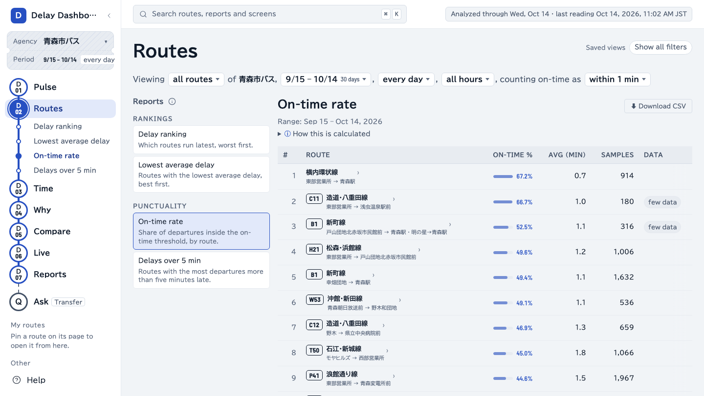

Sorted by **On-time rate**, the table is followed by “Headway quality”, which covers the routes scheduled every 12 minutes or more often, and by “Minimum performance standard” when the agency has set targets for its routes.

### 5-6. A route’s own page

Clicking a route’s name — in a report, in **Routes to check** on Pulse, or in the Live trip list — opens that route’s page.

- At the top, “Routes / (route name)” leads back to the list, and the page states its question: “Where does delay build up?”. **Pin**, to the right of the heading, adds the route to **My routes** in the sidebar (chapter 2).
- Below it are the route’s mean delay (and its place among the agency’s routes, most delayed first), on-time rate, share over 5 minutes late and share of all lateness — the same figures as the **Routes** lists. “This route by time of day” and “Why this route runs late” open **Time** and **Why** for this route.
- The filters under it — “Route”, “Service pattern”, “From”, “To”, “Days” and “Time” — take effect when you press **Apply**. Until then the page says “Changes not applied yet”.
- **Delay by stop** shows the mean departure delay at each stop. When the route runs more than one path, pick one under “Path”; “Other direction” switches to the path running the other way. The page says what share of the route’s observations the path holds.
- A sentence names the segment where delay grows most, and the next largest, and the chart marks the largest. A segment’s increase is the mean change for the same trips observed at both of its stops. The segment from the first stop is left out, since most feeds report a first departure as on time.
- Tick “Compare with the previous period” to add the same number of days just before the selected ones (for Sep 24 – Oct 23, Aug 25 – Sep 23).
- Four tabs: “Along the route” (the delay stop by stop), “Trips over time” (each trip on the most recent day the route ran), “Map” and “Stop table”. Pick a stop under “Selected stop” to see its figures.
- **Download CSV** downloads the stop figures. **Save analysis** keeps these conditions in this browser, to reopen from **Reports → Saved analyses** (section 10-2).

The figures are means along the chosen path. They show where delay builds up; they do not by themselves establish its cause.

---

## 6. Time — when delay happens

Time holds **Trend**, **Routes on weekdays**, **Routes on weekends and holidays** and **Route forecast**.

### 6-1. Trend

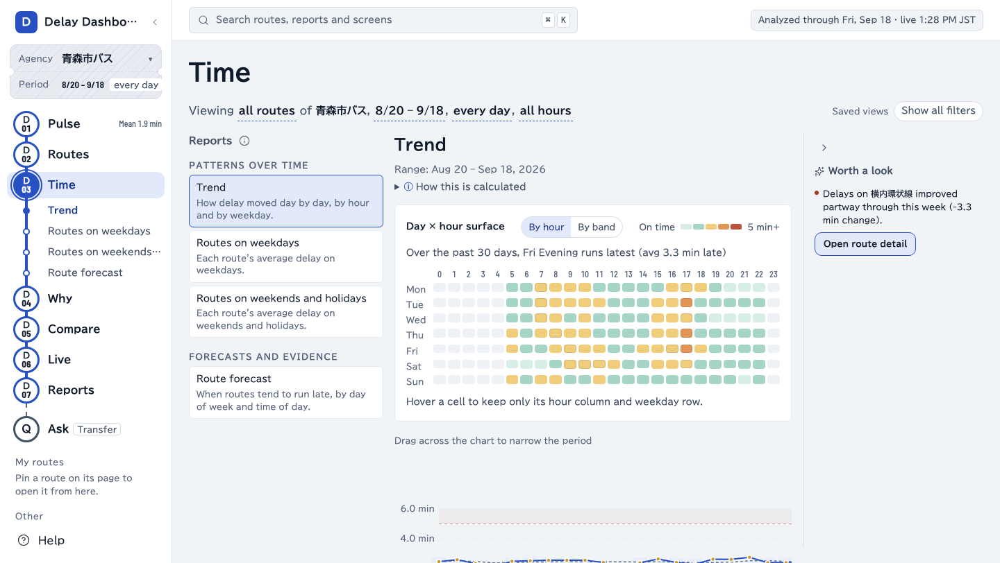

- **Day × hour surface**: the days of the week against the hours of the day. Darker cells mean more delay, an inset ring marks a cell over the moderate or severe threshold, and a faint cell rests on few observations. “By hour” shows each hour; “By band” averages the same period by time band. Pointing at a cell keeps only its hour column and weekday row, and the other charts pick out the same weekday. The sentences above the grid name the day and hour that ran latest over the period (such as “Fri 18:00”) and, averaged by time band, the day and band that ran latest, each with its average. The hour’s average covers that one hour and the band’s pools all of its hours, so the two figures differ. An hour or band with few observations is left out of them.
- The daily chart: the average delay day by day, with a dashed 7-day average and a “Schedule change” mark where a new timetable took effect. A rising line means delays are growing. Drag across the chart to narrow the period (“Drag across the chart to narrow the period”); “Reset period” undoes it.
- **Time-band heatmap**: hours 0–23 down the side, dates along the bottom. Darker means more delay. Click a cell to narrow the screen to that day and time band.

The shading has five steps, “under 1.5 min”, “1.5–2.5 min”, “2.5–3.5 min”, “3.5–5 min” and “5 min or more”, shown in each chart’s legend; the same minutes are the same colour on every screen. The time bands are the same as the scope sentence’s time-of-day choices: late night 0–5h, morning 5–9h, late morning 9–12h, midday 12–14h, afternoon 14–17h, evening 17–20h and night 20–24h.

A trend needs more than one day. For a one-day period, only the heatmap is shown, with a suggestion to pick a longer period.

### 6-2. Routes on weekdays, and on weekends and holidays

Each route’s average delay (“Avg (min)”, with “Samples”) on the days the agency ran its weekday timetable, or its weekend or holiday timetable. Each day goes by the timetable the agency ran that day, so a public holiday on a weekday, or a weekday the timetable runs as a holiday (such as Obon), counts as a weekend or holiday. Compare the two to see which routes run later on weekends and holidays. These reports choose their own days, so a days or timetable condition in the scope sentence shows as not used.

### 6-3. Route forecast

When routes tend to run late, by day of week and time of day. “Day × time of day (all routes)” shows the agency as a whole, and “Routes that ran late” lists the routes. Click one, or pick it from the “Route” list, for that route’s breakdown.

- Where the machine-learning model forecasts, the dates it forecasts and “ML forecast” appear at the top; “How accurate is it?” opens the model evaluation page. A forecast figure combines the forecasts for the trips that run in that hour.
- A route’s headline names the hour it is likely to run latest (such as “Fri 10/30 18:00”), then the time band that runs latest. When that hour is a forecast, it also gives the range about 8 trips in 10 fall in (“8 runs in 10 within 3.0–17.2 min late”). Only an hour’s forecast has a range; a band or an all-routes figure does not.
- A band’s figure averages its hours (on the all-routes grid, each route’s hours), weighted by how often each was observed before, using the forecast where there is one and the past average otherwise.
- On a screen with forecasts, a cell that shows a past average because the model has no forecast for it carries a small ring, shown in the legend as “No forecast: past average”.

---

## 7. Why — what the data can explain

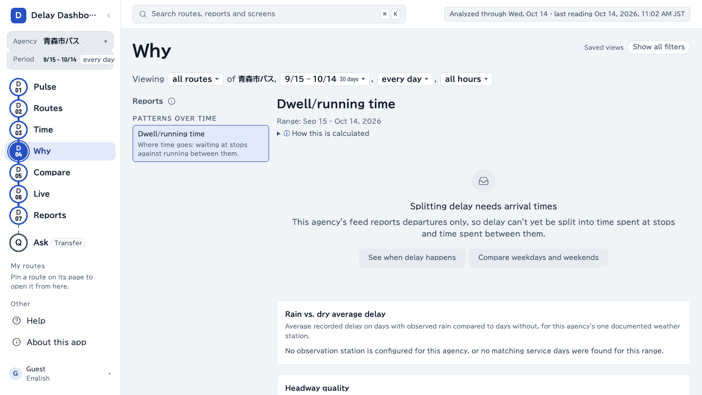

**Dwell/running time** shows, for each route, the dwell at stops (“Dwell avg”, “Dwell p50”, “Dwell p90”) and the time spent running between them (“Running avg”, “Running p50”, “Running p90”), in seconds, with the number of observations behind each. These are the times actually taken, not delays (chapter 13).

- Beside it are “Rain vs. dry average delay”, which compares days with and without rain, and “Headway quality”, which covers the high-frequency routes.
- The analyses that can be shown come first. The rest are gathered under “Analyses not shown” at the end, each with one of these marks and a sentence giving the reason:
  - “Not supported”: arrival times and related records can’t be taken from the agency’s feed, or the last check found the feed lacks a field the analysis needs.
  - “Needs re-check”: the check of whether the feed sends arrival times and related data has expired and awaits a re-check. The day of the last check is given too.
  - “Not checked”: whether the feed sends arrival times and related data hasn’t been checked yet.
  - “No observations”: there are no observations in this period from which dwell or running time can be calculated.
  - “Not set up”: no weather station is set up for the agency.
  - “Not applicable”: the timetable has no route scheduled every 12 minutes or more often.
- When dwell/running time can’t be shown, **See when delay happens** (the Time screen) and **Compare weekdays with weekends and holidays** (the comparison in section 8-1) are offered.
- The split cannot be narrowed to one time band. With a time band chosen, the report says so; choose “All hours” in the scope sentence to see it.

---

## 8. Compare — side by side

Two buttons at the top switch between **Weekdays and weekends/holidays** and **Agencies**.

### 8-1. Weekdays and weekends/holidays

**Weekday and weekend/holiday gap** draws each route’s average delay on weekdays and on weekends and holidays as bars, with both figures (“Weekday (min)”, “Weekend/Holiday (min)”) and, under “Gap”, which side runs later and by how much, such as “Weekday 3.9 min later”. Routes with the largest gap come first (“Largest gap”); “Weekday: latest first” and “Weekend/Holiday: latest first” rank by one side instead. The side the list is ranked by (weekdays, for the largest gap) is the solid bar and the other a dashed outline. The axis is 6, 12, 18 or 24 minutes, whichever holds every figure shown, and does not change when you switch the order. Days are split the same way as in the reports of section 6-2, so public holidays count as weekends and holidays.

### 8-2. Agencies

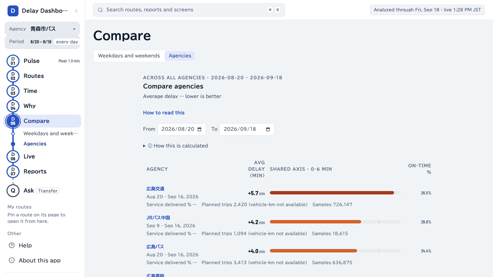

“Compare agencies” lists every agency for the dates in “From” and “To”, latest-running first (“Average delay — lower is better”). An agency whose data stopped reads “No updates after Oct 14” or similar, as on the agency picker, and comes after the agencies whose data is current. The agency selected in the sidebar carries a “Viewing” badge.

Each row shows “Avg delay (min)” with its bar, “On-time %”, “Planned trips”, “Service delivered %”, “Vehicle-km delivered %” and “Samples”. Every bar shares one axis, 6, 12, 18 or 24 minutes, whichever holds the latest-running agency. Where an agency has data for only part of the period, its own dates are shown too. Planned trips are the trips the timetable planned over the period; where a timetable plans only some of its days, the figure says so, such as “16/30 days a timetable plans”. Where Service delivered % cannot be shown, “—” is followed by the reason (“no timetable plans this period”, “this feed format cannot report cancellations” or “the feed is not yet checked for cancellations”). Vehicle-km delivered % appears only where Service delivered % does. A “Behind” badge means that agency’s totals have not caught up with its latest data yet. “How to read this” explains each figure. Where ridership weights have been set up, “Weight by ridership” switches the on-time figure to a ridership-weighted one.

Click an agency’s name to open that agency’s **Live** screen.

---

## 9. Live — the trips running now

Live shows the trips reporting now, under the heading “Current observations”. It refreshes itself every 30 seconds, and **Refresh now** fetches at once. Beside it, “Last updated …” says how recent the last report is, or “Feed quiet for …” when reports have stopped.

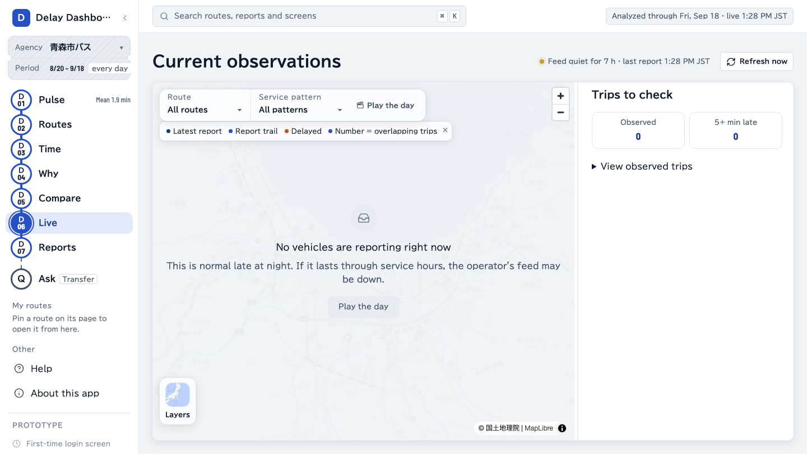

- The map places each trip at its last reported stop, not at a GPS position. The legend explains the marks: “Latest report”, “Report trail”, “Delayed” and “Number = overlapping trips”. Hover over a trip for its details; “Pin this trip” keeps them on screen. “Fit all trips in view” moves the map to frame every trip, and **Layers** switches the map style.
- Filters on the map: choose a “Route” and a “Service pattern”, then press **Apply**.
- **Play the day** replays the day’s observations on the map; “Back to current observations” returns to now.
- **Trips to check**, on the right: “Observed”, “5+ min late” and “On-time rate” for the trips reporting now, **Download CSV** for those trips, and a list of the trips running five minutes or more late, latest first. Each trip in the list links to its route’s page. “View observed trips” lets you pick a running route, a direction and a trip, and follow how its delay has developed.

When no vehicle is reporting, the map says why. Late at night (00:00–05:00) it says “No vehicles are reporting right now”, which is normal. When no new report has arrived for more than ten minutes during service hours, it says when the last one came and how long ago, and that the operator’s feed may have stopped. “Observed” and “5+ min late” then read “—” rather than 0, and “Show last reported positions” draws the last reported positions on the map, labelled as not current.

The first time you open Live, a three-step tour points out the filters, the trip list and the search field. “Later” closes it for now; “Got it” finishes it.

---

## 10. Reports — documents to hand on

Three tabs along the top: **Period summary**, **Saved analyses** and **Council report & delay record**.

### 10-1. Period summary

How service ran over the period, on one printable page: the scope sentence, then “Mean delay over time” (a chart) and “Mean delay by service pattern” (a table, where “Open analysis →” opens that route’s page). Each part has its own **Download CSV**. The **Export** menu at the top right offers “Download PNG”, “Download CSV”, “Create share link” and “Print / Save as PDF”. At the bottom, “View filters and definitions” links to the detailed reports.

Missing observations are not counted as on time; only the periods with observations are shown.

### 10-2. Saved analyses

The analyses you saved with **Save analysis** on a route’s page. Click one to reopen it with the latest data; **Delete** removes it. They are kept in this browser only, so another browser or device will not show them.

### 10-3. Council report & delay record

The list on the left holds **Council report** and **Delay record (for reference)**.

**Council report** is a period summary written for a council or board: four headline figures (“On time”, “Average delay”, “Departures observed”, “Planned trips”), a written summary with its notes, and **Print / Save as PDF**. Planned trips, the service-delivered rate and the data-quality note always cover the whole agency for the period; when a route, day, service or time-of-day condition narrows the on-time figures, the tile and the summary say “whole agency”.

**Delay record (for reference)** gives a passenger a record of a late departure. This service makes it from the real-time data the operator publishes, as a reference document; it is not a delay certificate issued by the operator, and the record says so.

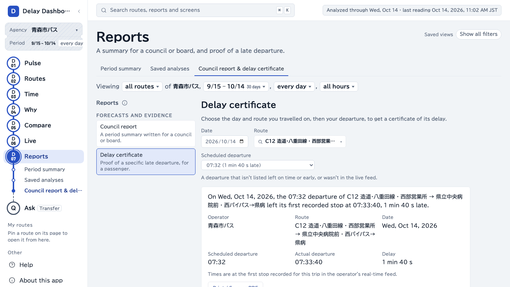

1. Choose the “Date” and the “Route” they travelled on (“Search routes”).
2. Under “Scheduled departure”, pick their departure (“Choose a departure”). Each one shows how late it left.
3. The record appears with a statement and the “Operator”, “Route”, “Date”, “Scheduled departure”, “Actual departure” and “Delay”. Times are at the first stop recorded for that trip in the operator’s real-time feed. Press **Print / Save as PDF**.

The list holds only departures that left late. A departure missing from it left on time or early, or was not in the live feed. If no departure of the route left late that day, the page says so.

For staff, “All late departures in the period” opens the full list under the scope sentence’s conditions, with **Download CSV**.

---

## 11. Ask — questions with ready answers

Ask answers common questions about delay with a table or chart, so you do not have to find the right report first. Open it with **Ask** in the sidebar, below the screens.

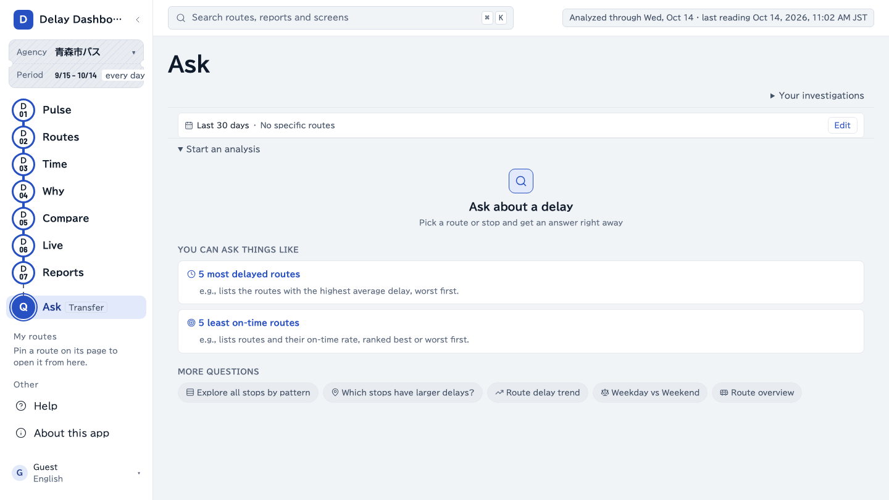

### 11-1. Asking a question

- The bar at the top shows the period and routes your questions will cover. **Edit** changes them (“Date range”, “DOW”, “Time band”, “Routes”); press **Apply** to keep the change.
- Under “You can ask things like”, a card runs at once: “5 most delayed routes” or “5 least on-time routes”.
- Under “More questions”, each question needs a route first: “Explore all stops by pattern”, “Which stops have larger delays?”, “Route delay trend”, “Weekday vs Weekend/Holiday” and “Route overview”. Pick the route, adjust any other setting, and press **Run**.
- After the first answer, open **Start another analysis** at the bottom to see every question. Choosing one opens its settings, such as “Top” and “Service” for the most-delayed-routes question.

### 11-2. Reading the answer

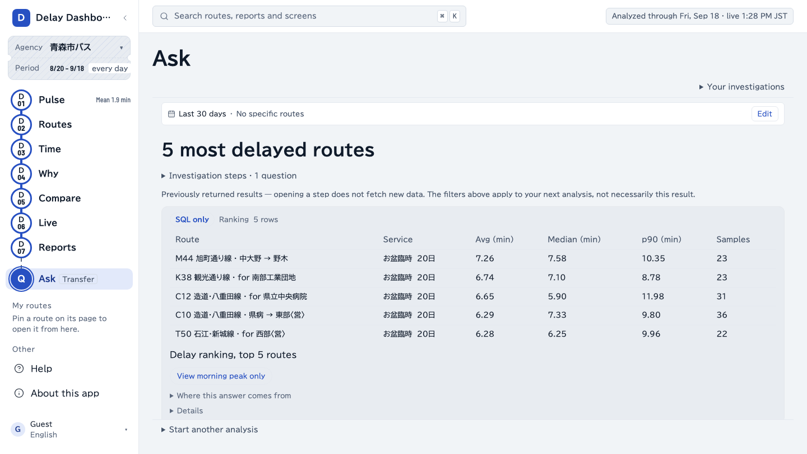

- The question heads the answer, with the table or chart under it.
- “Where this answer comes from” names the route, the conditions and how the figures were made. A “SQL only” badge means they were computed directly from the data; “LLM” marks a summary written by a language model from a result already fetched.
- Buttons under the answer suggest next steps, such as “View morning peak only”, “View on the map”, “Compare with two weeks ago” and “Save as PNG”.
- “Download result (JSON)”, and a CSV for each table, save the answer.
- Each question becomes a step of the investigation. “Investigation steps” lists them so you can look back; “Return to latest” brings you back to the newest.

### 11-3. Asking about the result in your own words

Where it is available to your account, a box under the latest answer, “Ask about this result...”, takes a question in your own words. Press the send button (the paper-plane icon) for an answer grounded in the result on screen. As the note under the box says, the AI runs only when you send, and it answers from the stored result without fetching new data. For a stop-by-stop answer, select a stop first.

The box is for digging into the result already on screen; to start a new ranking, use a question card instead. If an answer cannot be produced, a message says why — the question is too long, traffic is high, or the connection dropped — so shorten the question, wait a moment, or try again.

When the box is not shown, free-text questions are not available to your account. The question cards still work, because they are computed directly from the data.

### 11-4. Your investigations

“Your investigations” at the top lists your earlier investigations by date. Search them, or start afresh with “New investigation”; each investigation’s menu renames, pins or deletes it. Without signing in, investigations are kept only in the browser where you asked them.

If you are not sure which report to open, picking a question on Ask is often the quickest way in.

---

## 12. Model evaluation — how the forecast model is checked

**Model evaluation**, under **Other** in the sidebar, shows how the ML model behind the route forecast on **Time** (6-3) is checked each week; its heading is “ML forecast model evaluation”. It opens without choosing an agency, and “← Back to (agency)” at the top returns to the Pulse of the agency you were viewing.

- The verdict: whether the latest evaluation was “Adopted” or “Not adopted (the previous model stays in use)”, when it was evaluated, and the model in use. When it was not adopted, “Why it was not adopted” lists the reasons.
- “Against the usual estimate”: how much less error the model’s forecast has than the usual estimate, which is the average delay at the same weekday and hour over the past 4 weeks. It also shows whether the “Adoption bar” was reached and how the gain varied by test day.
- “Runs inside the forecast range”: the share of actual delays that fell inside the forecast range, against its target.
- “By agency”: how each agency was scored (“On the model”, “Partly on the model” or “On the usual estimate (too little history)”), its comparison with the usual estimate and its mean error. An agency whose route forecast uses the model is marked “In the route forecast now”.
- “Past evaluations”: each week’s date, verdict and comparison with the usual estimate.

The evaluation is updated every Sunday. Until the first one, the page says “No evaluation yet.” When ML forecasts are not in the route forecast, the page says so at the top.

---

## 13. Glossary

What the words on the screens and in this manual mean.

### 13-1. Units of data

- **Feed**: the data an agency publishes. Delays are the departure delays its real-time feed (GTFS-Realtime) reports at each stop, used as they are; the Service does not work delays out from the timetable and vehicle positions. Route names, scheduled times, timetables and planned trips come from the timetable feed (GTFS).
- **Reading** (“Samples” in the tables): one trip departing one stop counts as one reading. When the same trip and stop are reported many times, the last report is used. “Samples” counts readings, so one trip gives one reading per stop.
- **Set aside as implausible**: a report more than 2 hours (7,200 seconds) late or early is left out as a feed fault.
- **Missing data**: days or hours with no readings are left out, not counted as on time.
- **Service day**: the date turns over at 04:00. A report that arrives between midnight and 04:00 counts toward the previous day.
- **Timetable type**: each day is classed by the timetable the agency ran that day, as weekdays, Saturdays, or Sundays & holidays; for an agency whose Saturday and Sunday timetables are the same, as weekdays or weekends & holidays. A day the timetable cannot class is classed by its day of the week and public holidays.
- **Route**: what the agency’s timetable codes as one route. Each row of the **Routes** table is one route. Route pickers put routes that share a name under one entry, with a count of its variants.
- **Service pattern**: on a route’s page, the “Route” filter picks a name that one or more routes share, and “Service pattern” picks one of those routes.

### 13-2. Delay figures

- **Average delay**: the mean of the readings’ departure delays, in minutes. Early departures stay in the mean as negative delays.
- **Early departure**: a reading that left before its scheduled time; its delay is negative.
- **On time** and **On-time %**: a reading is on time when its departure delay is within the on-time tolerance (1 minute unless changed), and early departures count as on time. On-time % is the share of readings that were on time.
- **Over 5 min**: a reading whose departure delay is more than 5 minutes (300 seconds), whatever the on-time tolerance. “Share over 5 min” is their share of the samples, and “Over 5 min (count)” is how many there were.
- **Live’s “On-time rate” and “5+ min late”**: Live takes the latest report of each trip reporting now. Trips 5 minutes or more late are “5+ min late”, and the share of the rest is the “On-time rate”, so it is counted differently from On-time % on the other screens.
- **p50 and p90**: the values halfway along (the median) and 90% of the way along when the values are sorted from smallest. p90 is a guide to a value exceeded about one time in ten. They are approximations, worked out from counts grouped into fixed-width steps.
- **wide margin**: shown when the 95% confidence interval (Wilson) of the on-time % is wider than ±5 points.
- **few data**: shown for a route with fewer than 100 samples.
- **Dwell**: the time, in seconds, from a trip’s arrival at a stop to its departure from it. The actual arrival and departure times are the scheduled times plus the delays the feed reports, so dwell is available only from feeds that report arrival delays.
- **Running**: the time, in seconds, from a trip’s departure from one stop to its arrival at the next. Where the stops in between have no report, it covers the whole stretch.

### 13-3. Service and spacing

- **Planned trips**: the number of trips the timetable planned to run over the period, counted day by day from the timetables running that day.
- **Service delivered %**: the share of planned trips not reported as cancelled. Trips the feed reports as cancelled, or as skipping a stop, are taken off the planned trips; a trip that never appears in the feed is not counted as cancelled. It shows “—” for a feed format that cannot report cancellations, or a feed a check has not confirmed reports them; Compare agencies gives the reason.
- **Vehicle-km delivered %**: service delivered % applied to the planned vehicle-km, so the share is the same as service delivered %; a cancelled trip’s distance is taken to be an average trip’s. It is left out where service delivered % is, and shows “—” for an agency whose timetable has no route shapes (shapes.txt).
- **Headway quality**: for routes whose planned headway (the median) is 12 minutes or less, how far the actual spacing strays. “Excess wait” is the average extra wait that the irregular spacing adds over the planned spacing.
