# 遅延ダッシュボード 利用マニュアル

このマニュアルは、遅延ダッシュボードを初めて使う方向けに、画面ごとの使い方を順に説明します。

画面写真は、青森市バスの実データで撮影したものです。写真の日付や数値は撮影したときのもので、いま開いた画面とは異なります。どの事業者でも画面の使い方は同じです。事業者のフィードが送っていないデータが必要なレポートでは、画面にその旨が表示されます。

---

## 目次

1. [事業者を選ぶ](#1-事業者を選ぶ)
2. [画面の移動](#2-画面の移動)
3. [表示の条件：画面上部の一文](#3-表示の条件画面上部の一文)
4. [概況 — 期間の全体像をつかむ](#4-概況--期間の全体像をつかむ)
5. [路線 — どの路線が遅れているか](#5-路線--どの路線が遅れているか)
6. [時間 — いつ遅れるか](#6-時間--いつ遅れるか)
7. [要因 — データで説明できること](#7-要因--データで説明できること)
8. [比較 — 並べて比べる](#8-比較--並べて比べる)
9. [ライブ — いま走っている便](#9-ライブ--いま走っている便)
10. [レポート — 人に渡す資料](#10-レポート--人に渡す資料)
11. [質問 — 用意された質問ですぐ答えを得る](#11-質問--用意された質問ですぐ答えを得る)
12. [モデル評価 — 予測モデルの検証結果](#12-モデル評価--予測モデルの検証結果)
13. [用語](#13-用語)

---

## 1. 事業者を選ぶ

アプリを開くと、まず見たい事業者（バス会社）を選ぶ画面が表示されます。

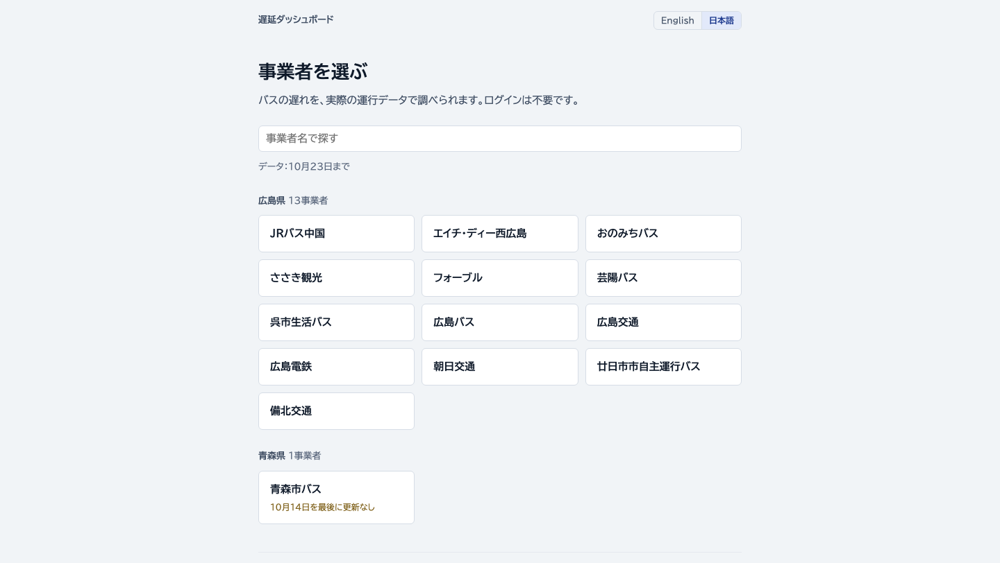

- 事業者は都道府県ごとにまとめて、事業者の多い都道府県から並びます。見出しの横の数は、その都道府県の事業者の数です。
- データがいつまであるかは、カードの上に「データ：…まで」として一度だけ表示されます。ほかの事業者より何日も前に更新が止まっている事業者のカードには「…を最後に更新なし」と表示されます。まだデータが届いていない事業者には「まだデータを収集していません」と表示されます。
- 同じ都道府県の中では、データのある事業者が名前の順に先に並び、更新の止まった事業者、データのない事業者が後に続きます。
- 事業者が多いときは、カードの上に「事業者名で探す」の欄が表示されます。
- 右上の言語の切り替えで、表示する言語を変えられます。いちばん下から、ヘルプ、このアプリについて、ログインの各ページを開けます。

カードをクリックすると、その事業者の**概況**画面（4章）が開きます。選んだ事業者は記憶され、次にアプリを開くと、その事業者の概況から始まります。登録されている事業者が1つだけのときは、この画面は表示されません。

### 事業者を切り替える

サイドバー上部の事業者メニュー（事業者名と▾）を開き、名前の一部を入力して絞り込み、別の事業者を選びます。同じ画面のまま、新しい事業者の内容に切り替わります。路線のページにいたときは、路線は事業者ごとに異なるため、**路線**の一覧に移ります。スマートフォンでは、事業者メニューは**その他**の中にあります。

画面上部の検索欄（2章）に事業者名を入力して切り替えることもできます。

---

## 2. 画面の移動

### サイドバー

画面左のサイドバーに、画面の一覧が並びます。それぞれの画面で、ひとつの種類の問いに答えます。各画面の名前の左の丸には、その画面のアイコン（スマートフォンの画面下部のバーと同じもの）が入ります。

| 画面 | わかること |
|---|---|
| **概況** | 期間中の運行の様子と、変わったこと |
| **路線** | どの路線が遅れているか・時間通りか、1つの路線を停留所ごとに見るとどうか |
| **時間** | いつ遅れるか：日ごと・時間帯ごと・曜日ごと |
| **要因** | 時間がどこでかかっているか：停留所での滞留か、停留所間の走行か |
| **比較** | 路線ごとの平日と土日祝の差、事業者どうしの差 |
| **ライブ** | いま走っている便 |
| **レポート** | 印刷したり人に渡したりする資料：期間のまとめ、協議会向け報告、遅延の記録（参考） |
| **質問** | 用意された質問に、表やグラフで答えます |

「その他」の下には、**モデル評価**（12章）、**ヘルプ**（このマニュアル）、**このアプリについて**があります。アプリ名の横の矢印で、サイドバーをアイコンだけに折りたためます。アイコンにカーソルを合わせると、画面の名前が表示されます。

サイドバー下部のアカウントメニュー（お名前、または**ゲスト**）には、ログイン、表示の**言語**、**外観**（システムの設定に合わせる・ライト・ダーク）があります。

### マイ系統

よく見る系統は、その系統のページ（5-6）の見出しの右にある「ピン留め」で、サイドバーの**マイ系統**に加えられます。マイ系統の各系統には今日の平均遅延が並び、クリックするとその系統のページが開きます。ピン留めは事業者ごとに5系統までで、もう一度「ピン留め」を押すと外れます。ピン留めはこのブラウザにだけ保存されるため、ログインしていなくても使えますが、別のブラウザや端末には表示されません。スマートフォンの画面では、マイ系統は表示されません。

### 検索して移動する

各事業者の画面の上部にある「路線・レポート・画面を検索」の欄を押すと、検索ボックスが開きます（ショートカットは Mac では⌘K、それ以外では Ctrl+K）。入力して、画面・事業者・路線・レポート・時間帯へ移動できます。

その横の「…まで集計」は、レポートに含まれる最後の運行日です。クリックすると「データの鮮度」が開き、レポートがいつまでのデータか、最後のライブ受信はいつか、異常値として除外した観測がどれだけあるかを確認できます。表示中の数値は、除外後の値です。観測のない日は定時扱いにせず、集計から外しています。

### スマートフォンでは

画面の幅が狭いときは、サイドバーの代わりに、画面下部のバーに**概況**・**路線**・**ライブ**・**質問**・**その他**が並びます。**その他**には、事業者メニュー、ほかの画面、モデル評価、ヘルプ、アカウントメニューがあります。

### 画面上部のお知らせ

概況・路線・時間・要因・比較の画面では、上部にお知らせが出ることがあります。

- 「データが最新ではありません — 最終取り込み: …」は、1日以上新しい観測が届いていないときに表示されます。データの収集が遅れているだけで、アプリの故障ではありません。×で閉じられます。
- 「異常値…件を集計から除いています。表示中の数値は除外後の値です。」は、直近7集計日の観測のうち0.1%以上を異常値として除外したとき（配信の停止・異常の可能性）に表示されます。それより少ないときはお知らせを出さず、件数は「データの鮮度」にだけ表示されます。×で閉じられます。

---

## 3. 表示の条件：画面上部の一文

**概況**・**路線**・**時間**・**要因**・**比較**（平日と土日祝）と、**レポート**の期間のまとめ・協議会向け報告では、画面の上部に、何を集計しているかを1つの文で示します（遅延の記録（参考）では、選んだ日付と路線がそのまま条件になるため表示しません）。初期の条件では次のようになります。

> （事業者名）の全路線を、（期間）のすべての曜日・全時間帯で、定時は1分以内として見る

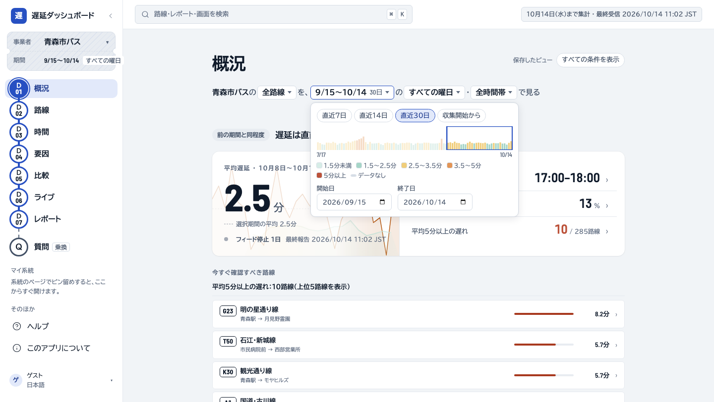

▼の付いたボタンが条件です。クリックすると変更でき、画面はすぐに更新されます。初期の状態から変えた条件は青く表示されます。期間のボタンには、その日数も表示されます。

| 条件 | 選べるもの |
|---|---|
| 対象の路線 | 1つ以上の路線、または全路線 |
| 期間 | 「直近7日」「直近14日」「直近30日」「収集開始から」、小さな日別グラフ上でドラッグした範囲、または「開始日」「終了日」の日付 |
| 曜日とダイヤ | 「すべて」「平日」「土日」、または曜日を個別に。「ダイヤの種類」も選べます |
| 時間帯 | 「全時間帯」、または「朝(05-09)」「夕(17-20)」などの時間帯 |
| 定時の幅 | 何分の遅れまでを定時とみなすか（「定時とみなす遅れ」）：1・3・5分。それぞれのときの定時率も表示されます |

「ダイヤの種類」の選択肢は、事業者の時刻表に合わせて「平日」「土曜」「日祝」、または土曜と日曜が同じダイヤの事業者では「平日」「土日祝」です。各日は、事業者の時刻表がその日に走らせたダイヤで分類されます（祝日は日祝・土日祝のほうに入ります）。

初期の期間は、データのある最新の日（1日分そろった日）までの30日間です。期間の選択肢も、その日で終わります。ダイヤの種類や、リンクから指定された停留所・方向・早発の幅は、条件として文に加わります。定時を数えない画面では、文は定時の部分の前で終わります。

条件を初期の状態から変えると、文の最後に「リセット」が表示されます。押すと、すべての条件を初期の状態に戻します。

画面の見出しの右側には次のボタンがあります。

- 「保存したビュー ▾」：保存したビューの一覧です。各ビューの名前の下にその条件が表示され、今の条件と同じビューには ✓ が付きます。選ぶとその条件に切り替わり、「×」で削除できます。「現在の条件を保存」を押すと、今の条件から提案された名前が入るので、そのままか書き換えて「保存」を押します。保存にはログインが必要です。ログインしていないときは「保存したビュー」とだけ表示され、「ログインで保存」のヒントが出ます。
- 「すべての条件を表示」：すべての条件の操作部品を、文の下に並べて表示します。もう一度押して切るまで、この表示が続きます。

この画面で使わない条件は取り消し線で表示され、文の下に「この画面では使いません：曜日とダイヤ」のように示されます。たとえば平日・土日祝の系統別遅延のレポートは、曜日を自分で決めています。

条件は画面ごとに記憶されます（このブラウザのタブを開いている間）。そのため、**路線**で期間を変えても、**時間**の期間は変わりません。条件はページのアドレス（URL）にも含まれるので、コピーしたリンクを開くと同じ表示になります。

ライブ・質問・路線のページ・事業者どうしの比較には、それぞれ専用の絞り込みがあります。各章で説明します。

---

## 4. 概況 — 期間の全体像をつかむ

概況は、事業者を選んだときに最初に開く画面です。画面上部の条件の期間をまとめて表示します。

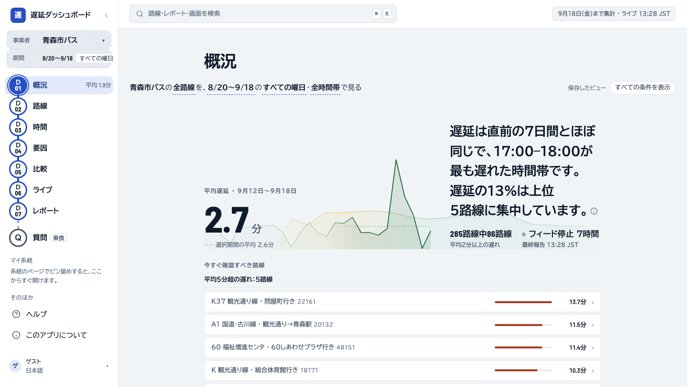

- いちばん上の一文：直近の日数（ふつうは7日間）の平均遅延と、その直前の同じ日数分の平均、その差（分と%）です。先頭の印は「前の…日間より +…分」「前の…日間より −…分」「前の…日間とほぼ同じ」のどれかです。「ほぼ同じ」とするのは、差が0.1分未満か、直前の平均の5%未満のときだけです。ⓘアイコンで比較のしかたを確認できます。
- 最新日の一文：期間の最後の日が、期間に観測した日のうち遅いほうから3番目以内のときに、その日の平均と順位を示します。観測数が同じ日種別のふだんの日の半分に満たない日（集計が一部だけの日）は、順位を付けません。
- 「直近…日間（…）の平均遅延」：平均遅延（分）です。背景に、日ごとの値の小さな線が描かれます。
- フィードの状態：平均遅延の下に、「受信中」「フィード停止 …」「まだ受信していません」のいずれかと、最終報告の時刻を示します。
- 平均遅延の横の3行：「最も遅れた時間帯」、「上位…路線への遅延の集中」（遅延のうち上位の路線が占める割合）、「平均…分以上の遅れ」（平均の遅れが一定の分数以上の系統の数と、直近の日数のあいだに100回以上観測した系統の数。下の**確認が必要な系統**に「平均…分以上の遅れ」の見出しが出るときは、その見出しと同じ数です）です。行をクリックすると、それぞれを説明するカードが開きます。「平均…分以上の遅れ」は、**確認が必要な系統**へ移動します。
- **確認が必要な系統**：直近の日数のあいだに100回以上観測した系統のうち、遅れの大きい系統を、平均の遅れの大きさごとにまとめて並べます。観測が少ない系統は、わずかな便で平均が大きく振れるため含めません。並ぶのは上位の系統だけです。まとまりに、並んでいるより多くの系統があるときは、その見出しが全体の系統数と「上位…系統を表示」を示します。各行の「前週比」は、直前の同じ日数分との差です（直前の観測が少ない系統には付きません）。各行の横棒は平均の遅れを、ほかの画面と同じ5段階の色で示し、一覧の下に凡例があります。系統をクリックするとその系統のページ（5-6）が、「…系統をすべて見る」をクリックすると、同じ日数の**路線**の表（5-3）が、平均の遅れの大きい順に開きます。「確認が必要な系統はありません」は、該当する系統がないという意味です。
- **遅延の集中度**・**時間帯別の悪化**・**サービス日別**：遅れが一部の路線に集中しているか、どの時間帯が最も遅れるか、日種別（平日・土曜・日祝。土曜と日曜が同じダイヤの事業者は平日・土日祝）でどう違うかを示します。日種別は、事業者の時刻表がその日に走らせたダイヤで決まります。日数か観測数が少ない日種別は「データ不足」と表示し、比較に含めません。カードをクリックすると拡大表示します。**時間帯別の悪化**では、時間をクリックすると、その時間帯に遅れた路線の一覧が開きます。

期間内に観測がないときは、その旨と、条件の変え方の提案が表示されます。

---

## 5. 路線 — どの路線が遅れているか

### 5-1. レポートの画面

**時間**・**要因**・**比較**（平日と土日祝）は同じ配置です。**レポート**の協議会向け報告と遅延の記録（参考）も同じ配置です。**路線**は、すべての系統を1つの表にまとめています（5-3）。

| エリア | 場所 | 内容 |
|---|---|---|
| 表示の条件 | 上部 | レポートが集計している条件（3章） |
| レポート一覧 | 左側 | この画面のレポート。「順位」「定時性」などのグループに分かれ、それぞれに1行の説明が付きます |
| レポート | 中央 | 選んだレポート：表やグラフ、対象の期間（「期間: …」）、書き出せる行があるレポートでは「CSVダウンロード」 |

画面を開くと、一覧の最初のレポートが表示された状態になります。一覧で別のレポートをクリックすると切り替わります。スマートフォンでは、一覧はレポートの上のプルダウンになります。

集計に時間がかかると、数秒後に「まだ処理しています…」と表示されます。期間が1週間より長いときは「まだ処理しています。期間が長いほど集計に時間がかかります。」と表示され、「期間の最後の7日間に絞る」ボタンが出ます。

### 5-2. 読み方に迷ったら ⓘ アイコン

一覧の上の「レポート一覧」の横にある小さなⓘをクリックすると、「レポートの読み分け」というポップアップが開き、レポートの種類ごとの使い道を説明します。

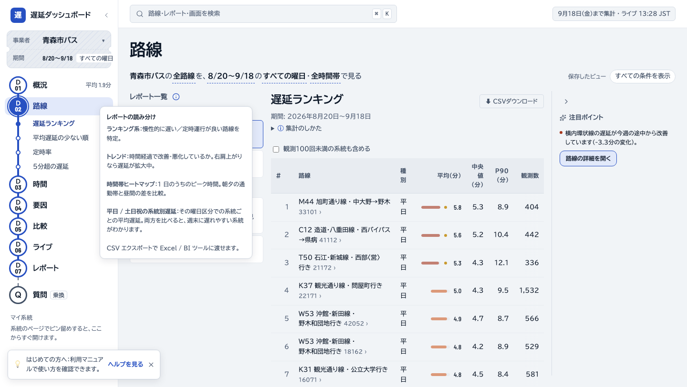

- ランキング系は、慢性的に遅い路線や、定時運行が良い路線を見つけるためのものです。
- トレンドは、改善しているか悪化しているかを見るためのものです。右肩上がりなら遅延が拡大中です。
- 時間帯ヒートマップは、1日のうちのピーク時間を示します。朝夕の通勤帯と昼間の差を比べられます。
- 平日 / 土日祝の系統別遅延は、事業者の時刻表がその日に走らせたダイヤで日を分けた、系統ごとの平均遅延です。祝日は土日祝に入ります。両方を比べると、土日祝に遅れやすい系統がわかります。
- CSV エクスポートで、Excel や BI ツールにデータを渡せます。

ほかの場所をクリックするか、Esc キーを押すと閉じます。

### 5-3. 路線の画面の表

**路線**の画面は、期間中に観測した系統を1つの表に並べます。1行が1系統で、期間中のその系統の観測をすべてまとめた値です。表の上に、集計した期間（「30日間（…）の集計」）が出ます。**概況**はより短い直近の期間で集計するため、同じ路線でも値が異なることがあります。

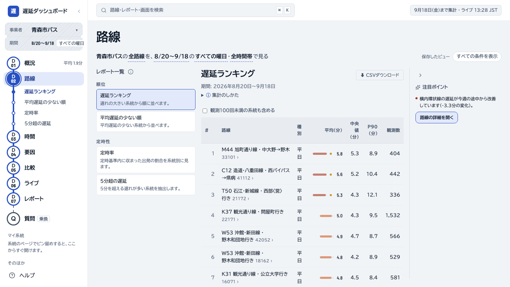

表の列：

- 「路線」：名前をクリックすると、その路線のページ（5-6）が開きます。同じ名前の系統がいくつかあるときは、どこを走るかも並べて表示します。
- 「平均（分）」：平均遅延です。
- 「定時率」：画面上部の条件にある定時の幅以内に出発した割合です。100%に近いほど良好です。「誤差大」は、定時率の95%信頼区間が±5ポイントより広く、割合を信頼しにくいことを示します。区間の広さは出発の数だけでなく定時率そのものにもより、50%に近いほど広くなります。バッジにポインタを合わせるかフォーカスすると、その系統の誤差（±ポイント）が出ます。
- 「5分超の割合」「5分超回数」：5分を超えて遅れて出発した割合と、その回数です。
- 「観測数」：その行の基になった観測の数です。少ないほど確かさは下がります。

「並べ替え」で、表を並べる値を選びます。

| 並べ替え | 並ぶ順 |
|---|---|
| **平均遅延** | 平均遅延の大きい系統から |
| **定時率** | 定時率の低い系統から |
| **5分超の割合** | 5分超の割合が高い系統から |
| **影響（件数）** | 5分超の回数が多い系統から。便の多い系統ほど上に来ます |

「良い順」を選ぶと、反対の端から並びます。並べ替えに使っている列は数値が太字になり、その列だけに横棒が付きます。サイドバーの**路線**の下にも、同じ4つの並べ替えが並びます。

どこから見ればよいか迷ったら、まず**平均遅延**でどの路線が悪いかを確認し、次に**時間**の**トレンド**でいつ悪いかを見るのがおすすめです。

### 5-4. 表に載る系統

期間中の観測が100回未満の系統は、どの並べ替えでも外しています。わずかな便数しか観測されていない系統が上位に来ないようにするためです。「観測100回未満の系統も含める」にチェックを入れると、それらも表に加わり、観測数に「データ少」のバッジが付きます。

今の時刻表にない運行終了の系統コードと、遅れが常に0と報告される系統も外しています。後者のデータは遅れを報告せず時刻表をそのまま返しているため、定時性を表しません。外した系統があるときは、表の上の「既定で除いている系統：」に理由ごとの件数付きのチェックボックスが出て、チェックを入れると表に戻ります。件数は並べ替えや表示件数によって変わりません。

表には上位50件が載ります。表に載りきらない系統があるときは、表の下に表示件数（「…件中…件を表示」）が出て、「すべて表示」で残りも一覧できます。表の下には、何を定時とみなしたか（たとえば「定時 = 遅れ1分以内（早発も定時に含む）。」）と、5分超の数え方が出ます。

「CSVダウンロード」で、表に載っている行を、表と同じ並べ替えでダウンロードできます。

### 5-5. 定時率で並べたとき

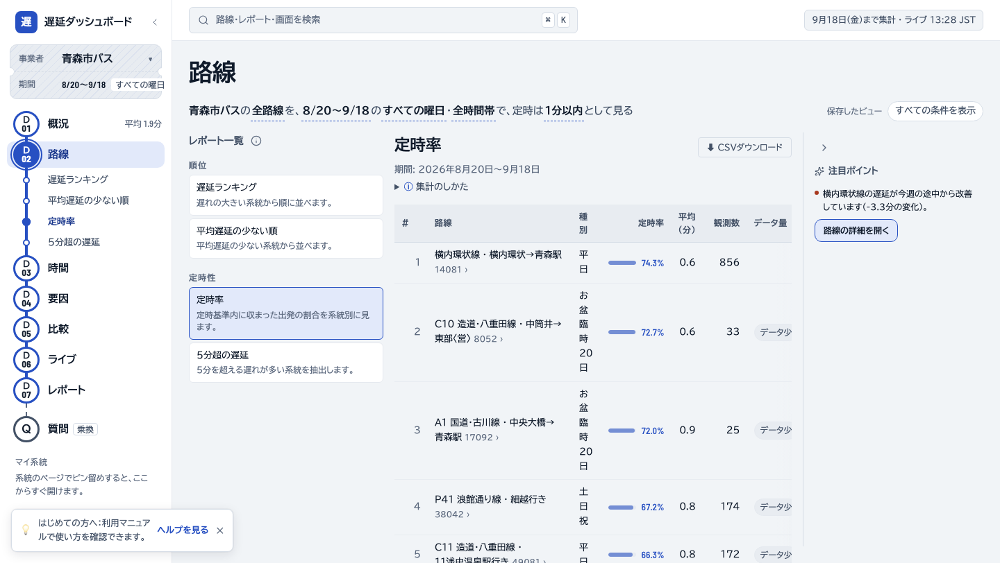

**定時率**で並べると、表の下に、計画運行間隔が12分以内の系統を対象とした「運行間隔の質」と、事業者が路線ごとの目標を設定している場合は「最低パフォーマンス基準」が表示されます。

### 5-6. 路線のページ

レポートの路線名、概況の**確認が必要な系統**、ライブの便の一覧から路線をクリックすると、その路線のページが開きます。

- 上部の「路線 / （路線名）」から一覧に戻れます。ページの見出しの下には、このページの問い「遅れが増えた区間を調べる」が表示されます。見出しの右の「ピン留め」で、この系統をサイドバーの**マイ系統**（2章）に加えられます。
- その下に、この系統の平均遅延（事業者の系統の中で遅れの大きい順に何位か）、定時率、5分超の割合、遅れの総量シェアが並びます。数値は**路線**の一覧と同じ集計です。「この系統の時間帯を見る」「この系統の遅れの要因を見る」から、**時間**と**要因**をこの系統で開けます。
- その下の絞り込み（「路線」「系統」「開始日」「終了日」「曜日」「時間帯」）は、「適用」を押すと反映されます。押すまでは「変更が未適用です」と表示されます。
- 「停留所ごとの遅延」は、停留所ごとの平均出発遅延を示します。系統に複数の運行経路があるときは「運行経路」で選べます。「逆方向」で反対向きの経路に切り替わります。選んだ経路が路線全体の観測の何%かも表示します。
- 遅れが最も増える区間と、次に大きい区間を文で示し、最も増える区間をグラフ上で強調します。区間の増加は、両方の停留所で観測された同じ便の差の平均です。始発からの区間は、多くの配信が始発の出発を定刻として報告するため除いています。
- 「前の期間と比較」にチェックを入れると、選んだ期間の直前の同じ日数（例：9/24〜10/23なら8/25〜9/23）の値も重ねて表示します。
- 4つのタブ：「路線に沿った遅れ」（停留所ごとの遅れ）、「ダイヤ図」（その路線が最後に運行した日の便ごとの運行）、「地図」、「停留所の表」。「選択した停留所」で停留所を選ぶと、その数値が表示されます。
- 「CSVダウンロード」で、停留所ごとの数値をダウンロードできます。「この分析を保存」で条件をこのブラウザに保存でき、**レポート**の「保存した分析」（10-2）から開き直せます。

数値は、選んだ運行経路に沿った平均値です。どこで遅れが増えるかは分かりますが、それだけで原因を示すものではありません。

---

## 6. 時間 — いつ遅れるか

時間には、**トレンド**・**平日の系統別遅延**・**土日祝の系統別遅延**・**路線別予測**があります。

### 6-1. トレンド

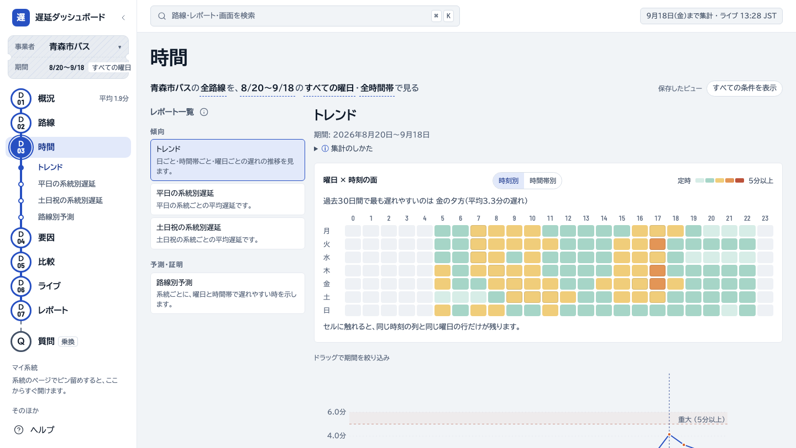

- **曜日 × 時刻の面**：曜日と時刻（0〜23時）の表です。色が濃いほど遅れが大きく、遅れが目立つマスには内側の縁取りが付き、観測の少ないマスは淡く表示されます。「時刻別」は時刻ごと、「時間帯別」は同じ期間を時間帯ごとに平均した色です。マスに触れると、その時刻の列と曜日の行だけが残り、ほかのグラフでも同じ曜日が強調されます。表の上の文は、期間中に最も遅れた曜日と時刻（「金曜18時台」など）と、時間帯でまとめたときに最も遅れた曜日と時間帯を、それぞれの平均とともに示します。時刻の平均は1時間ぶん、時間帯の平均はその時間帯のすべての時刻をまとめた値なので、2つの数字は違います。観測の少ない時刻と時間帯は、この文には出ません。
- 日ごとのグラフ：日ごとの平均遅延の推移です。点線の「7日移動平均」と、新しいダイヤが反映された日の「ダイヤ改正」の印が付きます。右肩上がりなら遅延が拡大中です。グラフ上をドラッグすると期間を絞り込めます（「ドラッグで期間を絞り込み」）。「期間をリセット」で元に戻ります。
- **時間帯ヒートマップ**：縦が時間（0〜23時）、横が日付です。色が濃いほど遅れが大きくなります。マスをクリックすると、その日のその時間帯に絞り込みます。

色の段階は「1.5分未満」「1.5〜2.5分」「2.5〜3.5分」「3.5〜5分」「5分以上」の5つで、各グラフの凡例に示します。どの画面でも同じ分数が同じ色です。時間帯は、画面上部の条件の「時間帯」と同じ区切り（深夜0〜5時・朝5〜9時・午前9〜12時・昼12〜14時・午後14〜17時・夕17〜20時・夜20〜24時）です。

トレンドには2日以上の期間が必要です。1日だけの期間では時間帯ヒートマップだけが表示され、期間を広げるよう案内が出ます。

### 6-2. 平日の系統別遅延・土日祝の系統別遅延

平日ダイヤ、または土日祝のダイヤで運行した日の、系統ごとの平均遅延（「平均（分）」と「観測数」）です。各日は、事業者の時刻表がその日に走らせたダイヤで分けるため、平日の祝日や、お盆など時刻表が土日祝のダイヤを走らせた平日は土日祝に入ります。両方を比べると、土日祝に遅れやすい系統がわかります。これらのレポートは日を自分で決めているため、画面上部の条件で曜日やダイヤの種類を指定していると、使わない条件として表示されます。

### 6-3. 路線別予測

系統ごとに、曜日と時間帯で遅れやすい時を示します。「曜日 × 時間帯（全路線）」で事業者全体を、「遅れやすかった路線」で系統の一覧を見られます。系統をクリックするか、「系統」の一覧から選ぶと、その系統の内訳を表示します。

- 機械学習モデルの予測があるときは、上に予測する日付と「ML予測」が出ます。「予測の精度を見る」で、モデル評価の画面に移ります。予測の値は、その1時間に走る便ごとの予測をまとめた値です。
- 系統の内訳の見出しは、最も遅れそうな時刻（「10/30（金）18時台」など）と、時間帯でまとめたときに最も遅れそうな時間帯を示します。時刻が予測のときは「10回中8回は3.0〜17.2分の遅れの範囲」のように、10回のうち8回ほどが収まる予測の幅も示します。幅は1時間ごとの予測にだけあり、時間帯や全路線をまとめた値には付きません。
- 時間帯の値は、その時間帯の各時刻（全路線では系統ごとの各時刻）を、これまでの観測数の重みで平均したものです。予測のある時刻は予測の値、ない時刻は過去の平均を使います。
- 予測のある画面で、予測がなく過去の平均を表示しているマスには小さな丸印が付きます。凡例の「予測のない時間（過去の平均）」がこの印です。

---

## 7. 要因 — データで説明できること

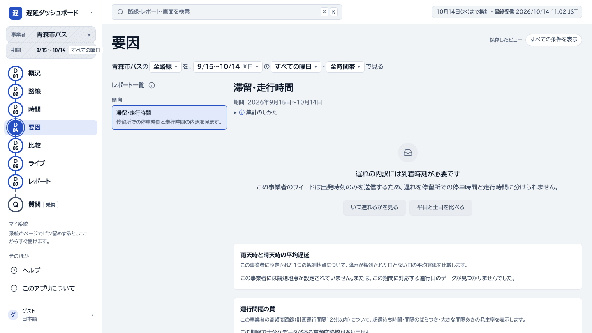

**滞留・走行時間**は、系統ごとに、停留所での滞留時間（「滞留平均」「滞留p50」「滞留p90」）と、停留所間の走行時間（「走行平均」「走行p50」「走行p90」）を、秒単位で示します。遅れの値ではなく、実際にかかった時間です（13章）。それぞれの観測数も表示されます。

- その下に、雨の日とそうでない日を比べる「雨天時と晴天時の平均遅延」と、運行頻度の高い系統を対象とした「運行間隔の質」が並びます。
- 表示できる分析が先に並びます。表示できない分析は、最後の「表示できない分析」にまとめ、それぞれに次の印と、理由を述べる1文を付けます。
  - 「非対応」：事業者のフィードから到着時刻などの記録を取り込めないか、最後の確認で、フィードに必要な項目がないと分かりました。
  - 「要再確認」：フィードが到着時刻などを送っているかの確認の期限が切れ、再確認を待っています。最後に確認した日も示します。
  - 「未確認」：フィードが到着時刻などを送っているかを、まだ確認していません。
  - 「観測なし」：この期間には、滞留・走行の時間を計算できる観測がありません。
  - 「未設定」：事業者に気象の観測地点が設定されていません。
  - 「対象外」：時刻表に、計画運行間隔が12分以内の系統がありません。
- 滞留・走行時間を表示できないときは、「いつ遅れるかを見る」（時間の画面）と「平日と土日祝を比べる」（8-1の比較）のボタンが出ます。
- この内訳は、時間帯を1つに絞っては見られません。時間帯を指定しているとその旨が表示されるので、画面上部の条件で「全時間帯」を選んでください。

---

## 8. 比較 — 並べて比べる

上部の2つのボタンで、「平日と土日祝」と「事業者どうし」を切り替えます。

### 8-1. 平日と土日祝

**平日・土日祝の差**は、系統ごとに平日と土日祝の平均遅延を棒で並べ、「平日（分）」「土日祝（分）」の値と、「差」の欄に「平日のほうが3.9分遅い」のように、どちらが何分遅いかを示します。初期の並び順は「差の大きい順」で、「平日の遅い順」「土日祝の遅い順」にも切り替えられます。棒は、並び順に選んだ側（差の大きい順では平日）を塗りで、もう一方を破線で示します。軸は、表示しているどの値も入るよう6・12・18・24分から決まり、並び順を切り替えても変わりません。日の分け方は6-2の系統別遅延と同じで、祝日は土日祝に入ります。

### 8-2. 事業者どうし

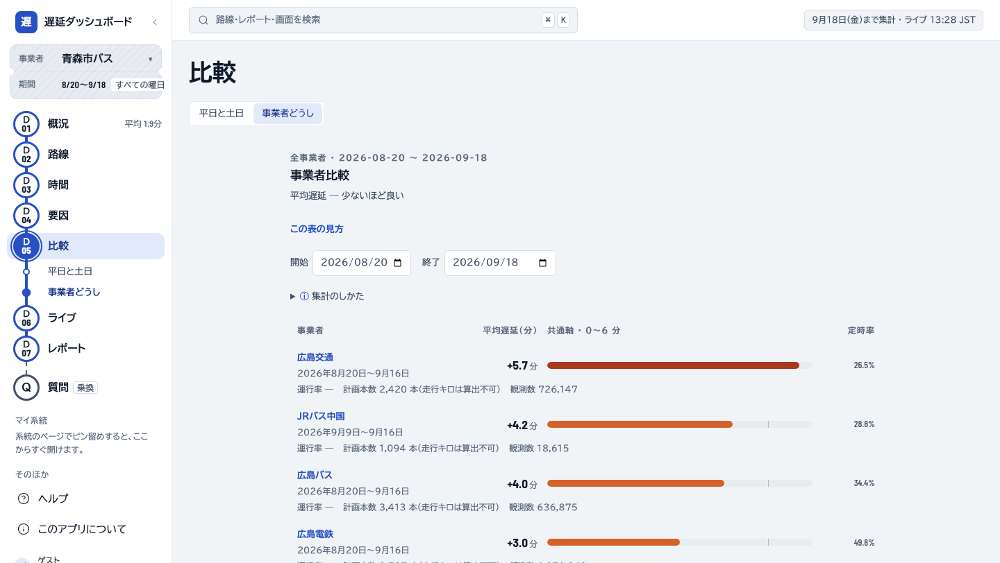

「事業者比較」は、「開始」「終了」で指定した期間のすべての事業者を、平均遅延の大きい順に並べます（「平均遅延 — 少ないほど良い」）。データが途中で止まった事業者には、事業者を選ぶ画面と同じく「10月14日を最後に更新なし」のように表示し、データが届いている事業者の後に並べます。サイドバーで選んでいる事業者には「表示中」のバッジが付きます。

各行には、「平均遅延（分）」とその棒、「定時率」、「計画便数」、「運行率」、「走行キロ達成率」、「観測数」が表示されます。棒の軸はすべての事業者に共通で、いちばん遅い事業者が入るよう6・12・18・24分から決まります。事業者のデータが期間の一部しかない場合は、データのある期間も表示します。計画便数は期間中に時刻表が計画した便の数で、時刻表に計画があるのが期間の一部の日だけの事業者には「時刻表に計画がある16/30日分」のように添えます。運行率が出ない事業者では、「—」の後に理由（「期間に時刻表の計画なし」「この配信形式は運休を伝えられません」「配信が運休を伝えるか未確認」「この配信は運休を伝えていません」）を表示します。走行キロ達成率は、運行率が出る事業者にだけ表示します。「未更新」のバッジは、その事業者の集計がまだ最新のデータに追いついていないことを示します。「この表の見方」で、各数値の意味を確認できます。利用者数の重みが設定されている場合は、「利用者数で重み付け」で、定時率を重み付けした値に切り替えられます。

事業者名をクリックすると、その事業者の**ライブ**画面が開きます。

---

## 9. ライブ — いま走っている便

ライブは、いま報告している便を表示する画面です（見出しは「現在の運行」）。30秒ごとに自動で更新され、「今すぐ更新」ですぐに取得できます。横の「最終更新 …」は最後の報告がいつかを示し、報告が止まっているときは「フィード停止 …」と表示されます。

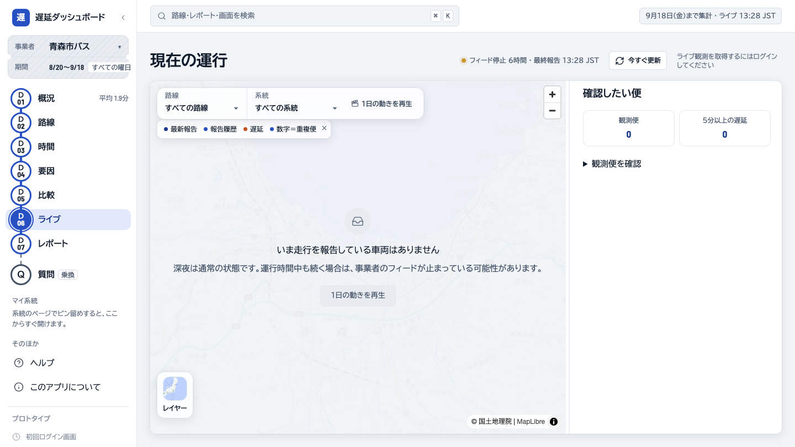

- 地図は、開いたときに事業者の停留所全体が入る範囲を表示します。車両が報告していない深夜でも同じです。
- 地図は、各便を最後に報告した停留所の位置に表示します（GPSの位置ではありません）。凡例で記号の意味を確認できます：「最新報告」「報告履歴」「遅延」「数字＝重複便」。便にカーソルを合わせると詳細が表示され、「この便を固定表示」で表示したままにできます。「全便を画面に収める」で全便が入るように地図を動かし、「レイヤー」で地図のスタイルを切り替えます。
- 地図上の絞り込み：「路線」と「系統」を選び、「適用」を押します。「路線」の各項目には、「くすの木台線（64・64-1）」のように系統番号を添えます。名前は配信のとおりに表示するため、表記の似た別の路線も番号で見分けられます。
- 「1日の動きを再生」で、その日の観測を地図上で再生します。「現在の運行に戻る」で現在に戻ります。
- 右側の「確認したい便」：いま報告している便の「観測便」「5分以上の遅延」「定時率」、それらの便の「CSVダウンロード」、5分以上遅れている便の一覧（遅れの大きい順）があります。一覧の各便から、その路線のページに移動できます。「観測便を確認」では、運行中の路線・方面・便を選んで、遅れの推移を確認できます。

報告している車両がないときは、地図にその理由を表示します。深夜（0〜5時）は「いま走行を報告している車両はありません」と表示され、通常の状態です。運行時間中に新しい報告が10分を超えて届かないときは、最後に届いた時刻と経過時間を示し、事業者の配信が止まっている可能性を伝えます。このとき「観測便」と「5分以上の遅延」は 0 ではなく「—」になり、「最終報告時点の位置を表示」で最後に届いた位置を、現在の位置ではないことを示したうえで地図に表示できます。

初めてライブを開くと、絞り込み・便の一覧・検索欄を案内する3ステップのツアーが表示されます。「後で」でいったん閉じ、「完了」で終わります。

---

## 10. レポート — 人に渡す資料

上部に3つのタブがあります：「期間のまとめ」「保存した分析」「協議会向け報告・遅延の記録」。

### 10-1. 期間のまとめ

期間中の運行を、印刷できる一枚にまとめます。画面上部の条件の文に続いて、「期間中の平均遅延」（グラフ）と「系統別の平均遅延」（表。「分析を開く →」でその路線のページが開きます）が並びます。

- グラフの下には、平均遅延が7日移動平均をいちばん大きく上回った日と、その日に遅れの大きかった系統を示します。
- 表は、平均遅延の大きい10系統です。すべての系統は「すべての系統を路線の表で見る →」から**路線**の表で見られます。
- 資料の出力は、右上の「エクスポート」メニューにまとめています：「PNG画像をダウンロード」「CSVダウンロード」（グラフの日ごとの値と、すべての系統の表）「共有リンクを作成」「印刷 / PDFで保存」。
- 下部の「集計条件・定義を見る」から、詳細レポートに移動できます。

欠測は定時運行として扱いません。観測がある期間のみ表示します。

### 10-2. 保存した分析

路線のページの「この分析を保存」で保存した分析です。クリックすると最新のデータで開き直し、「削除」で消せます。このブラウザにだけ保存されるため、別のブラウザや端末には表示されません。

「保存したビュー」（3章）は別の仕組みです。ログインして画面上部の「保存したビュー ▾」から保存した条件はアカウントに保存され、どの端末でも同じメニューから開けます。このタブには表示されません。

### 10-3. 協議会向け報告・遅延の記録

左の一覧に、**協議会向け報告**と**遅延の記録（参考）**があります。

**協議会向け報告**は、協議会に出すための期間のまとめです。5つの主な数値（「定時率」「平均遅延」「観測データ数（停留所単位）」「計画便数」「運行率」）、文章のまとめと注記、「印刷 / PDFで保存」ボタンがあります。

- 「観測データ数（停留所単位）」は、便が停留所を出発した記録の数です（13-1）。1つの便は停留所の数だけ数えるので、計画便数よりずっと大きくなります。
- 時刻表に計画があるのが期間の一部の日だけのときは、計画便数に「※時刻表に計画がある16/30日分」のように添えます。運行率も同じ日だけを数えます。
- 運行率が出ないときは「—」と、その理由を**比較**の事業者どうしと同じ言葉で示します（「配信が運休を伝えるか未確認」など）。
- 注記の「定時の定義」は、「定刻から1分以内の遅れ（早発も定時として数えます）」のように、集計に使った定時の幅を示します。
- 計画便数・運行率・データ品質の注記は、いつもこの期間の事業者全体の値です。路線・曜日・ダイヤ・時間帯の条件で定時率などを絞り込んでいるときは、数値の見出しとまとめに「事業者全体」と表示されます。

**遅延の記録（参考）**は、乗客に便の遅れの記録を渡すためのものです。事業者が公開しているリアルタイムデータをもとに本サービスが作成した参考資料で、事業者が発行する遅延証明書ではありません。記録にもその旨が記載されます。

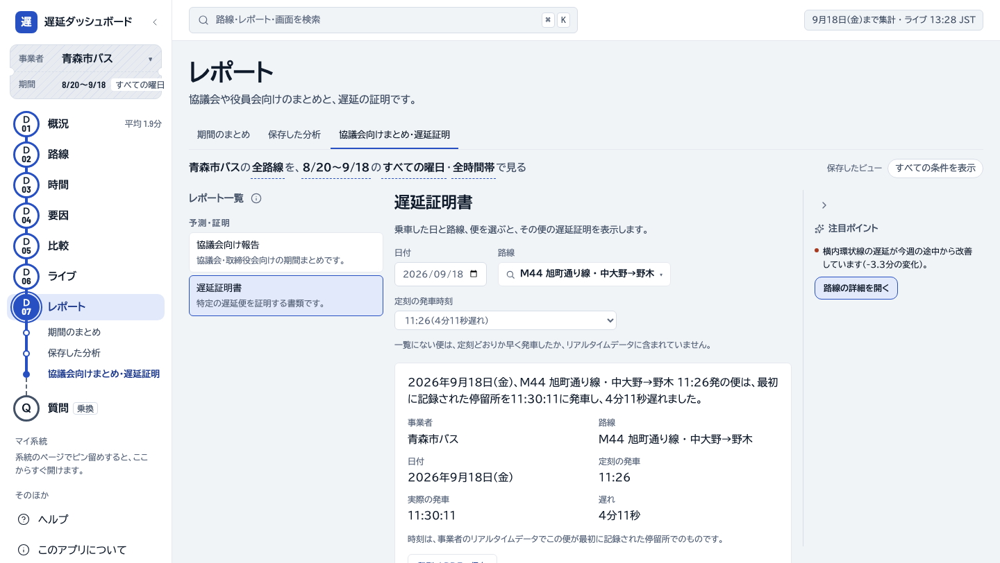

1. 「日付」で乗車した日を選びます。選べるのは、データがある最後の日までです。
2. 「路線」（「路線を検索」）で乗車した路線を選びます。
3. 「便」で乗車した便を選びます（「便を選択」）。各便は「17:42 広島駅 発（8分遅れ）」のように、定刻、時刻を記録した停留所、遅れた時間で表示されます。

記録が表示されます。「17:42発の便は、広島駅を8分遅れて発車しました（17:50）。」のような文と、「事業者」「路線」「日付」「停留所」「定刻の発車」「実際の発車」「遅れ」が記載されます。「印刷 / PDFで保存」を押します。

時刻は、乗車した停留所ではなく、リアルタイムデータでこの便が最初に記録された停留所でのものです。その停留所が時刻表でこの便の始発のときは「始発側の「広島駅」での発車時刻です。」と、始発でないときはそのことを、記録に書き添えます。時刻表に停留所名がないときは「最初に記録された停留所」と表示します。

一覧には、遅れて発車した便だけが並びます。一覧にない便は、定刻どおりか早く発車したか、リアルタイムデータに含まれていません。その日にその路線で遅れて発車した便がなければ、その旨が表示されます。

職員向けには、「遅れた便の一覧」を開くと、選んだ日のすべての路線で遅れて発車した便の一覧と「CSVダウンロード」が表示されます。一覧は開いたときだけ読み込みます。表の「記録した停留所」には、時刻表でその便の始発の停留所なら「始発」と付きます。

---

## 11. 質問 — 用意された質問ですぐ答えを得る

質問は、遅延についてよくある質問に、表やグラフで答える画面です。レポートを探し回らずに答えを得られます。サイドバーの画面一覧の下にある**質問**から開きます。

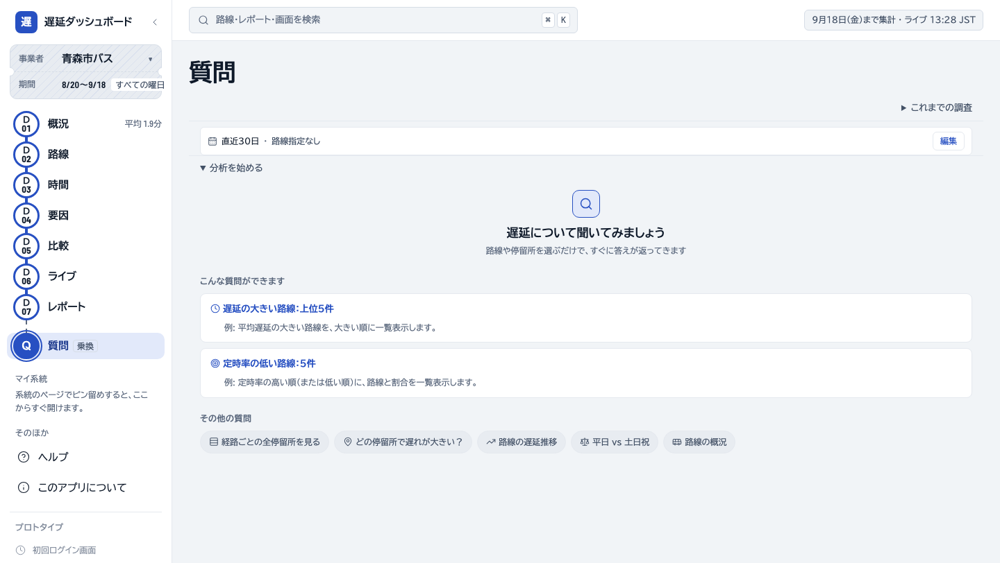

### 11-1. 質問する

- 上部のバーには、質問の対象となる期間と路線が表示されます。「編集」で変更でき（「期間」「曜日」「時間帯」「路線」）、「適用」で確定します。
- 「こんな質問ができます」のカードは、押すとすぐに答えが出ます：「遅延の大きい路線：上位5件」「定時率の低い路線：5件」。
- 「その他の質問」は、先に路線を選ぶ質問です：「経路ごとの全停留所を見る」「どの停留所で遅れが大きい？」「路線の遅延推移」「平日 vs 土日祝」「路線の概況」。路線を選び、必要ならほかの設定も変えて「実行」を押します。
- 最初の答えが出た後は、下部の「別の分析を始める」を開くと、すべての質問が並びます。選ぶと、その質問の設定が開きます（遅延の大きい路線の質問なら「件数」と「運行種別」）。

### 11-2. 答えの見方

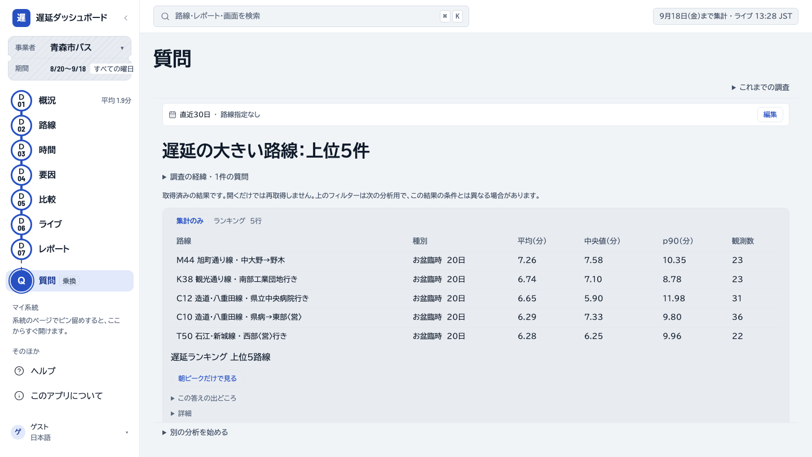

- 答えの見出しは質問で、その下に表やグラフが表示されます。
- 「この答えの出どころ」で、路線・条件・集計方法が分かります。「集計のみ」のバッジは集計から直接算出した値であること、「AI 回答」は取得済みの結果をもとに生成AIが書いた要約であることを示します。
- 答えの下のボタンで、次の一歩を選べます：「朝ピークだけで見る」「地図で見る」「先々週と比べる」「PNGで保存」など。
- 「結果を保存（JSON）」と表ごとのCSVで、答えを保存できます。
- 質問はそれぞれ、調査の1ステップになります。「調査の経緯」で過去の質問を振り返り、「最新の結果に戻る」で最新に戻れます。

### 11-3. 結果について自分の言葉で質問する

お使いのアカウントで利用できる場合は、最新の答えの下に「この結果について質問...」の入力欄が表示されます。文章で質問を入力し、送信ボタン（紙飛行機のアイコン）を押すと、表示中の結果に基づいた答えが返ってきます。入力欄の下の注記のとおり、AIは送信したときだけ動作し、新しいデータは取得せずに、保存済みの結果をもとに答えます。停留所ごとの答えでは、先に停留所を選んでください。

この入力欄は、表示中の結果を深掘りするためのものです。新しいランキングを作るときは、質問のカードを使ってください。答えられなかった場合は、原因（質問が長すぎる、アクセスが集中している、通信が途切れた）に応じたメッセージが表示されます。質問を短くする、少し待つ、もう一度試す、などで対応してください。

入力欄が表示されないときは、お使いのアカウントでは自由入力の質問を利用できません。質問のカードは集計から直接算出するため、そのまま使えます。

### 11-4. これまでの調査

上部の「これまでの調査」に、過去の調査が日付ごとに並びます。検索したり、「新しい調査」で新しく始めたりできます。各調査のメニューから、名前の変更・ピン留め・削除ができます。ログインしていない場合、調査は質問したブラウザにだけ保存されます。

どのレポートを見ればよいか迷ったときは、質問の画面で聞きたいことを選ぶのが早い場合があります。

---

## 12. モデル評価 — 予測モデルの検証結果

サイドバーの「その他」にある**モデル評価**は、**時間**の路線別予測（6-3）に使うML予測モデルを、毎週どう検証したかを示すページです（見出しは「ML予測モデルの評価」）。事業者を選ばなくても開けます。上部の「← （事業者名）に戻る」で、見ていた事業者の概況に戻れます。

- 判定：最新の評価が「採用」か「不採用（前のモデルを継続）」か、評価日、使用中のモデルを示します。不採用のときは「採用されなかった理由」が並びます。
- 「従来の見込みとの比較」：モデルの予測の誤差が、従来の見込み（過去4週の同じ曜日・同じ時間帯の平均遅延）よりどれだけ小さいかです。「採用基準」に届いたかと、検証日ごとの改善の幅も示します。
- 「予測範囲に収まった割合」：実際の遅れが予測の範囲に収まった割合と、その目標です。
- 「事業者別」：事業者ごとの評価のされ方（「モデルで評価」「途中からモデルで評価」「履歴不足のため従来の見込み」）、従来の見込みとの比較、平均誤差です。モデルの予測が路線別予測に使われている事業者には「路線別予測に反映中」と表示されます。
- 「これまでの評価」：週ごとの評価日、判定、従来の見込みとの比較です。

評価は毎週日曜に更新されます。まだ評価がないときは「まだ評価がありません。」と表示されます。ML予測が路線別予測に出ていないときは、ページの上部にその旨が表示されます。

---

## 13. 用語

画面とこのマニュアルで使う言葉の意味です。

### 13-1. データの単位

- **フィード**：事業者が公開しているデータです。遅れは、リアルタイムのフィード（GTFS-Realtime）が停留所ごとに報告する出発の遅れを、そのまま使います。本サービスが時刻表と車両の位置から遅れを計算しているのではありません。路線名・定刻・ダイヤ・計画便数は、時刻表のフィード（GTFS）から取ります。
- **観測**・**観測数**：1つの便が1つの停留所を出発した記録を、1件の観測と数えます。同じ便・同じ停留所の報告が何度も届いたときは、最後に届いた値を使います。観測数はその件数なので、1つの便は停留所の数だけ観測になります。協議会向け報告の「観測データ数（停留所単位）」も、この件数です。
- **異常値として除外**：遅れや早発が2時間（7200秒）を超える報告は、配信の不具合として集計から外します。
- **欠測**：観測のない日や時間は、定時として扱わず、集計から外します。
- **運行日**：日付は午前4時で切り替わります。午前0時から4時前までに届いた報告は、前の日の運行として数えます。
- **ダイヤの種類**：各日を、事業者の時刻表がその日に走らせたダイヤで、平日・土曜・日祝に分けます。土曜と日曜が同じダイヤの事業者では、平日・土日祝です。時刻表から決められない日は、曜日と祝日で分けます。
- **系統**：事業者の時刻表が1つのコードで表す運行のまとまりです。**路線**の表の1行が1系統です。
- **路線**：名前が同じ系統のまとまりです。路線を選ぶ欄では、同じ名前の系統が1つにまとめて表示されます。

### 13-2. 遅れの数字

- **平均遅延**：観測の出発の遅れを平均した値（分）です。早発はマイナスのまま平均に含めます。
- **早発**：定刻より早く出発した観測です。遅れはマイナスになります。
- **定時**・**定時率**：出発の遅れが定時の幅（初期は1分）以内の観測を定時とし、早発も定時に含めます。定時率は、観測のうち定時だった割合です。
- **5分超**：出発の遅れが5分（300秒）を超えた観測です。定時の幅を変えても変わりません。「5分超の割合」は観測数に対する割合、「5分超回数」はその件数です。
- **ライブの「定時率」と「5分以上の遅延」**：ライブでは、いま報告している便ごとに最新の報告を1件だけ使い、遅れが5分以上の便を「5分以上の遅延」、それ以外の便の割合を「定時率」とします。ほかの画面の定時率とは数え方が違います。
- **p50**・**p90**：値を小さい順に並べたときに、50%（中央値）と90%の位置にある値です。p90 は、10回に1回はそれより長くなる目安です。一定の幅で区切って数えた分布から求める近似値です。
- **誤差大**：定時率の95%信頼区間（Wilson 法）の幅が±5ポイントより広いときに付きます。
- **データ少**：観測数が100回未満の系統に付きます。
- **滞留**：便が停留所に着いてから出発するまでの時間（秒）です。実際の到着・出発の時刻は、時刻表の定刻にフィードが報告する遅れを足して求めます。そのため、到着の遅れを送るフィードでだけ求められます。出発は、フィードが到着を報告した後に報告したものだけを数えます。到着より前にしか報告がない出発は予測なので、滞留には数えません。
- **走行**：便が前の停留所を出発してから、次の停留所に着くまでの時間（秒）です。途中の停留所の報告がないときは、その区間をまとめた時間になります。

### 13-3. 運行の量と間隔

- **計画便数**：時刻表が期間中に走らせる予定だった便の数です。日ごとに、その日に走るダイヤの便を数えます。時刻表に計画があるのが期間の一部の日だけのときは、「時刻表に計画がある16/30日分」のように、数えた日数を添えます。
- **運行率**：計画便数のうち、運休と報告されなかった便の割合です。フィードが運休、または停留所の通過と報告した便を、計画便数から引いて求めます。フィードに一度も現れなかった便は、運休として数えません。運休を伝えられない配信形式の事業者や、フィードが運休を伝えることを点検で確かめられていない事業者では「—」になります。期間内にも期間の終わりまでの90日間にも、フィードが運休や停留所の通過を一度も伝えていない事業者も「—」です。何も引かれず、実際の運行にかかわらず100%になってしまうためで、フィードが運休を伝え始めれば値が出ます。事業者どうしの比較と協議会向け報告では、その理由を添えます。
- **走行キロ達成率**：計画した走行キロに運行率を当てはめた値で、割合は運行率と同じです。運休した便の距離は、平均的な便と同じとみなします。運行率が出ない事業者では表示せず、時刻表に経路の形（shapes.txt）がない事業者では「—」になります。
- **運行間隔の質**：計画の運行間隔（中央値）が12分以内の系統について、実際の間隔の乱れを示します。「超過待ち時間」は、間隔の乱れのために、計画どおりの間隔のときより余計にかかる平均の待ち時間です。
